# Audit 0 : tokens, typographie et composants

Phase 0 du chantier design et typographie. Base : `origin/main` à `bfc52fb`, mesures du 2026-11-06. Aucun fichier de code n'a été modifié : ce rapport et le dossier `docs/design/audit-0/` sont les seuls ajouts.

## L'essentiel

Le socle tient : CLS à 0 partout, accessibilité Lighthouse à 100 sauf sur la fiche produit (98), contraste vert sur les deux palettes, polices à 76,5 Ko, 385 `min-h-11` en place. Ce qui donne l'impression d'un produit assemblé vient de l'application du système : 7 styles de `h1`, 16 tailles de texte rendues, 74 écritures différentes pour 99 éléments à fond orange, un hero qui s'écrit dans 3 feuilles de style.

Quatre constats pèsent plus que les autres :

1. Le texte courant n'atteint jamais 16 px sur l'accueil : 0 % du texte à cette taille, 53 % sous 14 px. Le sous-titre du hero est à 13 px.
2. La fiche produit cache ce qui décide de l'achat : prix à y ≈ 915 px, bouton de paiement à y = 1 520 px (2 020 px pour un produit physique) sur un écran de 800 px. Elle n'a pas non plus de `<main>`, donc son lien d'évitement ne mène nulle part.
3. La cible de LCP sur 3G lent est hors d'atteinte par le design : le premier affichage seul prend 5 s sur toutes les pages mesurées. Sur l'accueil, le LCP est une photo de 91 Kio en chargement différé et non redimensionnée.
4. Le brief entre en conflit avec le dépôt sur 20 points (section suivante). Certains de ces points sont des décisions que vous avez déjà prises (V-18, V-20, V-22, V-24), d'autres sont gardés par des tests.

## Décisions à prendre

Chaque point donne les options, la recommandée en premier. Vos consignes du 2026-09-04 et du 2026-10-12 s'appliquent : « sans préférence » vaut option recommandée, sauf pour les deux arrêts fermes (A11 et A13), où il me faut votre réponse.

Pour lancer la Phase 1, seuls A1 à A9 sont nécessaires.

### Phase 1 : fondations

**A1. Les oranges du brief.** Le brief demande `#f5934f` (primaire), `#f26a21` (CTA), `#fdb868` (ambre) et un token `--orange-primary`. En mode clair, ces valeurs échouent à la porte de contraste que l'invariant 5 du brief exige de garder verte : `#f5934f` rend 2,16:1 sur crème, `#f26a21` 2,89:1, `#fdb868` 1,62:1. Le dépôt utilise `--color-brand #e0580f` (fond de CTA, 3,56:1) et `--color-accent #b8500c` (prix et texte, 4,73:1), décision V-20 (`docs/02-DECISIONS.md:29`), avec un cliquet à deux oranges (`tests/palette-resserree.test.ts:50`). Les hex du brief existent, mais seulement dans le bloc sombre (`app/zabelie-theme.css:249-250`).
- Garder les tokens actuels et écrire le mot d'accent en `--color-accent` (recommandé).
- Prendre les hex du brief, au prix de la porte de contraste et de V-20.

**A2. Mot d'accent orange et règle « orange pour CTA et prix ».** L'invariant 2 du brief réserve l'orange aux CTA et aux prix, la Phase 1.2 demande un mot de titre en orange. V-22 (`docs/02-DECISIONS.md:32`) n'autorise qu'une dérogation pour les décors de l'accueil, et V-24 A5 rappelle la règle.
- Nouvelle dérogation nommée, limitée à un mot d'accent par titre, à consigner en V-25 (recommandé).
- Mot d'accent en serif italique, couleur encre, sans orange.

**A3. Retour d'une serif et budget de polices.** V-20 avait retiré Playfair à votre demande ; le brief réintroduit une serif, je le consigne comme nouvelle décision. Le poids dépasse le budget avec `next/font/google` :

| Police d'accent | Fichier | Total avec Inter et Manrope | Budget 90 Ko |
|---|---|---|---|
| Instrument Serif Italic, `latin` Google | 22 128 o | 98,7 Ko | dépassé |
| Fraunces Italic 600 statique, `latin` Google | 23 032 o | 99,6 Ko | dépassé |
| Fraunces Italic variable, `latin` Google | 81 520 o | 158,0 Ko | dépassé |
| Instrument Serif, ASCII et accents | 18 208 o | 94,7 Ko | dépassé |
| Instrument Serif, lettres et accents seuls | 10 988 o | 87,5 Ko | tenu |
| Fraunces Italic 600, lettres et accents seuls | 10 076 o | 86,6 Ko | tenu |

Base servie aujourd'hui : Inter 52 088 o et Manrope 24 436 o, soit 76 524 o. Les deux candidates portent `è ò à ê ç é ï` et les chiffres dans leur version `latin`.
- Sous-ensemble local en `next/font/local`, sur le modèle d'Inter (`scripts/decouper-police-inter.sh`), lettres et accents seuls, gardé par un test de glyphes (recommandé). Conséquence : pas de chiffre ni de ponctuation dans un mot d'accent.
- Relever le budget à 100 Ko et garder `next/font/google`.
- Renoncer à la serif.

Préchargement : le brief le permet au-dessus de la ligne de flottaison. La mesure du 2026-10-17 l'a retiré parce qu'il retardait le premier affichage de 0,86 s à 2,1 s (`app/layout.tsx:47-57`, `tests/polices-chargement.test.ts:17`). Je recommande de ne pas précharger, en `swap`.

**A4. Mode sombre.** Le brief le place hors périmètre en demandant de ne pas l'ajouter. Il existe déjà : sélecteur dans l'en-tête (`components/site-nav.tsx:107`), bloc complet (`app/zabelie-theme.css:238-301`), contraste contrôlé sur les deux palettes, parité gardée (`tests/theme.test.ts:55`).
- On le garde : chaque nouveau token de couleur ou d'ombre reçoit sa valeur sombre, contrôle au script de contraste, sans travail de finition dédié (recommandé).
- Le retirer, chantier séparé.

**A5. Titre de 48 à 56 px, deux lignes au plus à 360 px.** La largeur utile du titre est de 272 px à 360 px (302 px à 390 px). Nombre de lignes mesuré à 360 px, Manrope 800, interlettrage −0,02em :

| Titre | 31 px | 36 px | 40 px | 44 px | 48 px | 56 px |
|---|---|---|---|---|---|---|
| HT « Òf vandè ayisyen yo » | 2 | 2 | 2 | 2 | 2 | 3 |
| FR « Les offres des vendeurs haïtiens » | 2 | 3 | 3 | 4 | 4 | 4 |
| EN « Offers from Haitian sellers » | 2 | 2 | 2 | 3 | 3 | 4 |
| ES « Ofertas de vendedores haitianos » | 3 | 3 | 3 | 3 | 3 | 4 |
| HT lancement « Konesans ou merite pwòp boutik li. » | 3 | 3 | 3 | 3 | 4 | 4 |
| FR lancement « Votre savoir-faire mérite sa boutique. » | 3 | 3 | 3 | 3 | 4 | 5 |

Le CTA reste au-dessus de 640 px dans tous ces cas (bas à 563 px avec 4 lignes à 48 px).
- `--text-display` à 36 px sur mobile, 56 px sur grand écran ; deux lignes en kreyòl, trois tolérées ailleurs et pour le titre de lancement, plus long (recommandé).
- Raccourcir les titres FR et ES pour tenir deux lignes : changement de texte à valider.
- 48 px partout : 4 lignes en français pour le premier visiteur, qui voit le français par défaut.

**A6. Corps à 16 px minimum.** Mesuré sur l'accueil à 360 px : 0 % du texte à 16 px, 38 % à 14 px, 53 % sous 14 px. Dans le code : `text-sm` ×950, `text-xs` ×444, `text-base` ×47. La revue du 2026-09-26 avait écarté ce point en attendant un essai sur téléphone (`docs/REVUE-2026-09-26-typographie.md:601`). Dans Tailwind v4, `--text-sm` commande l'utilitaire : le changer modifierait 950 usages d'un coup.
- Migration par rôle : 16 px pour les paragraphes, descriptions et champs ; 14 px pour les métadonnées ; 12 px pour le légal et les badges. Écran par écran, phases 2 à 4 (recommandé).
- Passer `text-sm` à 16 px partout : boutons, cartes à deux colonnes et tableaux de bord à revoir ensemble.

**A7. Trois rayons.** Le brief demande `--radius-sm` 8, `--radius-md` 12, `--radius-lg` 20. Usage réel : `rounded-xl` (20 px) ×384, `rounded-2xl` (16) ×157, `rounded-lg` (8) ×123, `rounded-full` ×51, `rounded-3xl` (24) ×7, `rounded-card` (12) ×4, plus 16, 18 et 24 px dans les CSS. Dans Tailwind, `--radius-lg` commande `rounded-lg` : 123 éléments passeraient de 8 à 20 px sans qu'aucune ligne ne change. `rounded-sm` et `rounded-md` sont refusés par `tests/ux-lot-d.test.ts:28`.
- Garder les noms `rounded-lg` 8, `rounded-card` 12, `rounded-xl` 20, et faire migrer `rounded-2xl` et `rounded-3xl` vers `rounded-xl` (recommandé).
- Adopter les noms du brief, en réécrivant les classes et le test.

**A8. Échelle d'espacement.** Le brief crée `--space-1` à `--space-12`. Tailwind fournit déjà cette échelle sur la base 4 px (`--spacing`). Les valeurs correspondent à `p-1` … `p-24`, mais les numéros divergent : `--space-10` vaudrait 64 px et `p-10` vaut 40 px. C'est un doublon au sens de votre invariant 6.
- Pas de `--space-*` : classes Tailwind dans le TSX, `--spacing(n)` dans les CSS, nettoyage des 108 valeurs `padding`, `margin` et `gap` en px relevées dans 6 feuilles, hors page « Ouvrir ma boutique » (recommandé).
- Créer les tokens du brief et vivre avec les deux numérotations.

**A9. « Aucune valeur en dur hors du thème ».** Certaines ne peuvent pas lire un token : images Open Graph (pas de variables CSS au rendu), `app/global-error.tsx` (remplace le layout, donc sans feuille de style), logos OAuth aux couleurs imposées (`components/connexion-form.tsx:69-80`), impression (`app/tableau-de-bord/boutique/affiche/affiche.css:11-12`).
- Liste d'exceptions nommées, tenue par un test (recommandé).
- Aucune exception : réécrire ces surfaces autrement.

### Performance

**A10. Profil de la cible de LCP.** Mesuré en 3G lent : premier affichage à 5 s sur l'accueil, la fiche et la connexion, LCP de 4,9 s sur la page la plus légère et de 15,3 s sur l'accueil (section Mesures). Une page pèse 305 à 399 Kio hors image, et ce profil débite environ 40 Ko/s.
- Cible de 2,5 s sur le profil 4G lent de Lighthouse (celui de `docs/home-premium/RAPPORT.md:40`), 3G suivie et rapportée sans seuil (recommandé).
- Garder 2,5 s en 3G lent : chantier d'architecture séparé, sans rapport avec ce chantier design.

**A11. Redimensionnement des photos (arrêt ferme : variable d'environnement, peut-être une dépense).** `NEXT_PUBLIC_SUPABASE_IMAGE_TRANSFORM` n'est pas active en production (`lib/product-image.ts:24`, `docs/41-AUDIT-VERCEL.md:347`) : la photo de la carte d'accueil arrive en taille d'origine, 91 Kio pour une vignette de 115 px de large. Lighthouse estime le gain à 87 Kio. L'activation dépend du plan Supabase (`OPS_TODO.md:2455`). Sans elle, la Phase 3 peut retirer le `loading="lazy"` de la première carte, sans tenir 2,5 s avec certitude.
- Vérifier le plan et activer la variable, geste à faire par vous ou à m'autoriser expressément.
- Laisser éteint pour l'instant.

### Phase 2

**A12. Badges « Vendeur vérifié » et « Livraison locale ».** `components/badge-identite.tsx:1-12` porte déjà « Identité vérifiée », décision du 2026-10-14, en couleurs neutres : il dit ce qui a été contrôlé et n'est pas une garantie. « Vendeur vérifié » promet davantage (`tests/promesse-vendeur.test.ts`, `docs/25-BOUCLE-DE-TRAVAIL.md:136`). « Livraison locale » contredit `docs/26-CAHIER-DES-CHARGES-MARKETPLACE.md:36` si elle laisse croire que Zabelie livre.
- Réutiliser `BadgeIdentite`. N'afficher une mention de remise que si le vendeur l'a déclarée, avec « par le vendeur » dans le libellé (recommandé).
- Ajouter les libellés du brief, ce qui engage une promesse commerciale.

### Phase 3

**A13. Sous-titre de paiement (arrêt ferme : promesse commerciale).** La phrase « MonCash et versement automatique à J+7 » n'est pas exacte aujourd'hui. Le versement n'est pas automatique : le solde devient disponible après J+7 (`lib/escrow.ts:9`) et le vendeur demande un retrait (`components/payout-request.tsx`, capture vendeur, pastille 5). MonCash est affiché en phase de test sur l'accueil en production (`lib/i18n.ts:2018`, « MonCash nan faz tès: pa gen peman reyèl. », maintenu par V-21). La formulation neutre que je vous soumets est celle déjà en ligne, dont je ne change pas un mot :
- HT : « Vandè a pa touche anvan li remèt li » (`lib/i18n.ts:3038`)
- FR : « Le vendeur n'est payé qu'après la remise » (`lib/i18n.ts:1418`)

J'attends votre accord ou votre texte.

**A14. Ordre mobile de l'accueil.** Le brief veut recherche, catégories, hero, produits, confiance. En ligne : recherche, hero, confiance, produits. Les catégories sont masquées sur l'accueil mobile pour tenir l'en-tête (`app/home-discovery.css:95`) et la confiance a été remontée à dessein après l'audit du 2026-10-17 (`app/page.tsx:292-297`, `tests/home-premium-structure.test.ts:115`). Mesuré à 360 px : hero jusqu'à y = 409, confiance jusqu'à 505, produits ensuite.
- Ordre du brief, avec la promesse portée par le sous-titre du hero (A13) et le test S8 mis à jour (recommandé). Estimation : −96 px pour la confiance, +66 px pour les catégories, soit le titre de la première rangée environ 30 px plus haut.
- Garder l'ordre actuel.

**A15. Preuve sociale et carte flottante.** État de la base au 2026-11-06 : 1 produit publié, 1 vendeur, 0 vendeur avec une zone déclarée, 0 produit noté, 0 commande payée. La pastille « N vendeurs actifs à Cap-Haïtien » n'aura donc rien à afficher pendant un temps. `components/home-featured.tsx` existe déjà pour la carte. Elle ne montrera pas de note tant qu'aucun produit n'en a.
- Réutiliser `SEUIL_VENDEURS = 3` (`lib/home-sections.ts:27`) et dessiner le hero pour qu'il tienne sans la pastille (recommandé).
- Fixer un autre seuil.

**A16. « Kreyòl-first » et langue par défaut.** Sans cookie, le site sert le français : décision V-18 (`docs/02-DECISIONS.md:30`), alors que `docs/25-BOUCLE-DE-TRAVAIL.md:134` pose le kreyòl d'abord. Le brief ne demande pas explicitement de changer ce défaut.
- Ne pas y toucher. Vérifier chaque écran en kreyòl puis en français, la langue la plus longue (recommandé).
- Rouvrir V-18, ce qui est une décision de positionnement.

### Phase 4

**A17. Connexion par téléphone.** L'authentification repose sur l'e-mail et OAuth, et `CLAUDE.md:45` exclut tout fournisseur SMS. La demande est conditionnée à ce que l'auth le permette : elle ne le permet pas, je la retire de la phase sauf avis contraire.

**A18. Checkout.** Le brief demande un indicateur d'étapes et un résumé collant en bas. Il n'existe pas de page de commande : « Verifye epi peye » renvoie à la fiche produit (`app/panier/page.tsx:186`) et le paiement groupé est fermé en production (`zabelie_panier_groupe_ouvert()` rend faux le 2026-11-06, message `lib/i18n.ts:325`).
- Reporter l'indicateur d'étapes et le résumé à l'ouverture du paiement groupé. En attendant, traiter le panier et le bloc de paiement de la fiche (recommandé).
- Dessiner une page de commande : nouvelle surface sur le chemin de l'argent, hors présentation pure.

**A19. Barre de navigation inférieure et bouton WhatsApp flottant.** L'en-tête porte déjà recherche, panier et compte ; une barre à 5 entrées les doublerait et prendrait environ 56 px de plus. Le bouton flottant recouvre aujourd'hui la flèche de la carte (capture accueil, pastille 5) alors que le brief refuse ce cas et que `tests/home-premium-structure.test.ts:108` l'impose.
- Barre inférieure et en-tête mobile allégé (panier et compte retirés). WhatsApp reste dans le menu (`components/site-nav.tsx:195-199`), le bouton flottant disparaît, S7 mis à jour (recommandé).
- Pas de barre inférieure, bouton flottant masqué uniquement au-dessus des cartes.

**A20. Fiche produit.** Elle ne figure dans aucune phase du brief, alors que c'est le défaut le plus coûteux relevé ici. `app/produit/[slug]/page.tsx` n'a pas de `<main>`, et Lighthouse le confirme (« No skip link target »). `tests/ux-lot-d.test.ts:54` ne peut pas le voir : il contrôle l'`id` des `<main>` présents, pas leur absence.
- L'ajouter à la Phase 4 : prix et bouton de paiement avant les blocs d'information, `<main id="main">` ajouté (recommandé).
- La traiter dans un chantier séparé.

## Comment lire les mesures

Trois sources, indiquées à chaque capture :

- Production : `zabelie.com`, en lecture seule, cookie `zabelie_lang=ht`, sauf la capture « première visite ». Service worker bloqué, contexte neuf à chaque page.
- Faux Supabase : build de production local avec le stub des tests E2E (`e2e/fixtures/stub-supabase.mjs`), pour l'espace vendeur et le panier rempli, que je ne peux pas atteindre en ligne sans compte. Données fictives. Le panier passe par un petit proxy d'audit hors dépôt.
- Fixtures : `ZABELIE_DEMO_FIXTURES=true`, pour voir la grille de cartes, puisque la production n'a qu'un produit.

Le dépôt étant public, les photos sont floutées et le nom du vendeur réel est remplacé dans les captures et dans `audit-0/mesures.json`. Le flou ne change aucune mesure : elles sont prises avant lui.

La sonde de mesure a d'abord menti : elle comptait comme cibles tactiles les liens cachés dans des `
` fermés et les libellés de champs. Corrigée, puis passée sur un cas connu (petit lien et case à libellé de 24 px signalés ; grand lien, lien de `
` fermé, `sr-only`, libellé et case à libellé de 50 px écartés).

Non couvert : parcours de paiement réel, messages d'erreur des formulaires, téléphone physique, captures en anglais et en espagnol, captures en mode sombre.

## Inventaire des tokens

Source : `app/zabelie-theme.css`.

| Famille | Ce qui existe | Défaut relevé |
|---|---|---|
| Fond | `--color-bg-1/2/3`, trois fois `#faf8f5` (`:60-62`) | Trois noms pour une valeur, gardés pour les usages existants |
| Surfaces | `--color-surface`, `-maroon`, `-neutral`, `-brown`, quatre fois `#fffdf9` (`:65-68`) | Idem, plus des noms hérités (`maroon`, `brown`) qui ne décrivent plus rien en clair |
| Accent | `--color-brand`, `--color-accent`, `--color-accent-strong` (`:74-76`) | `accent-strong` est un alias de `accent` |
| Encre | `--color-cloud` = texte, `--color-ink` = surface claire (`:99-101`) | Couple inversé, piégeux, documenté dans le fichier |
| Chrome | `--color-chrome`, `-2`, `-3`, `--color-on-chrome` (`:92-98`) | `--progress-done: #17123a` répète `chrome` en dur (`:208`) |
| États | `success`, `warning`, `danger`, `info`, chacun avec `-text` (`:122-132`) | Aucun |
| Illustrations | `--color-illus-1/2/3` (`:118-120`) | Aucun |
| Polices | `--font-sans`, `--font-heading`, `--font-mono` (`:146-150`) | Pas de `--font-accent`, attendu en Phase 1 |
| Tailles de texte | Aucune : valeurs Tailwind par défaut | Échelle du brief à poser ; seul `.titre-section` donne un rôle (`app/globals.css:190-194`) |
| Espacement | Aucun : `--spacing` de Tailwind | Voir A8 |
| Rayons | `--radius-xl` 20 px, `--radius-card` 12 px (`:152-156`) et la règle écrite (`:164-185`) | Six crans, voir A7. `--radius-button` est lu mais jamais défini (`app/editorial-marketplace.css:5`) |
| Ombres | Aucune | `shadow-xl` ×5, `shadow-lg` ×3, 6 ombres écrites à la main |
| Z-index | Aucun | Six valeurs brutes, voir plus bas |
| Mouvement | `--motion-fast/base/slow`, `--ease`, à 0 sous mouvement réduit (`:202-225`) | Aucun : conforme au brief |

Valeurs en dur hors du thème dans `app/` et `components/`, hors `app/api` : 95 hex, 14 fonctions de couleur, 107 tailles de police, 41 rayons, 6 ombres.

Exceptions à nommer (A9) :
- `app/opengraph-image.tsx:24-30`, `app/createur/[id]/opengraph-image.tsx:13-19`, `app/produit/[slug]/opengraph-image.tsx:18-24`. Ces fichiers portent un troisième orange, `#feb56c`, absent de la palette.
- `app/global-error.tsx:34-47`
- `components/connexion-form.tsx:69-80`
- `app/tableau-de-bord/boutique/affiche/affiche.css:11-12`

À ramener vers les tokens :
- `app/home-vivant.css:36,39,44,92,141`
- `app/ouvrir-ma-boutique/etal.css:23-34` : une palette locale `--etal-*` qui recopie les tokens, plus les lignes 55, 58, 59, 112, 155, 156, 372, 373, 378
- `components/home-vivant.tsx:15-19,47,51,87,96`
- `components/etal-dessin.tsx:20-27`
- `components/etal-page.tsx:307-308,539-540`
- `components/haiti-map.tsx:83` : `rgba(124, 92, 255, …)`, un violet hors palette, sur une page d'administration

Ombres écrites à la main : `app/home-vivant.css:39,70,141`, `app/ouvrir-ma-boutique/etal.css:106,206,211`.

Z-index bruts : `z-50` ×8 (`components/site-nav.tsx:70`, `components/account-menu.tsx:29`, `components/lang-toggle.tsx:155`, `components/theme-toggle.tsx:64`, `components/seller-pixels.tsx:42`, `components/admin/identity-block.tsx:58`, `components/admin/online-status.tsx:74`, `app/connexion/page.tsx:41`), `z-40` ×2 (`components/search-box.tsx:128`, `components/whatsapp-fab.tsx:18`), `z-[60]` (`components/site-nav.tsx:79`), `z-10` (`components/authoring-editor.tsx:915`).

L'ancienne palette n'a plus qu'une trace : `#ff6b00` dans le faux résultat d'essayage (`lib/essayage/fournisseurs/simulation.ts:32`), sans effet sur l'interface. `DM Sans` et `#080808` sont absents du code.

## Inventaire typographique

Polices chargées (`app/layout.tsx:58-71`) : Inter 4.1 découpée, variable de 100 à 900, 52 088 o ; Manrope variable, sous-ensemble `latin`, 24 436 o. Les deux en `swap`, sans préchargement.

Usage dans le code :

| Classe | Occurrences |
|---|---|
| `text-sm` | 950 |
| `text-xs` | 444 |
| `text-lg` | 73 |
| `text-2xl` | 61 |
| `text-base` | 47 |
| `text-3xl` | 46 |
| `text-xl` | 38 |
| `text-4xl` | 10 |
| `text-5xl` | 2 |
| `text-[11px]` | 1 (`components/site-nav.tsx:139`) |

Graisses : `font-semibold` ×492, `font-bold` ×88, `font-medium` ×52, `font-extrabold` ×51, `font-black` ×14, `font-normal` ×4. Interlignes : `leading-relaxed` ×57, très peu d'autres. S'y ajoutent 107 `font-size` dans 11 fichiers, dont 25 dans `app/home-discovery.css` et 23 dans `app/editorial-marketplace.css`.

Rendu à 360 px : 16 tailles différentes sur les écrans mesurés (11, 12, 13, 14, 16, 17, 18, 19, 20, 22, 24, 30, 31, 32, 36, 56 px). `app/globals.css:26-27` annonce pourtant une échelle mobile 28 / 20 / 16 / 14.

Répartition du texte à 360 px :

| Écran | Sous 14 px | 14 px | 15 et 16 px | Au-dessus |
|---|---|---|---|---|
| Accueil | 53 % | 38 % | 0 % | 9 % |
| Catalogue | 50 % | 48 % | 0 % | 2 % |
| Fiche produit | 28 % | 69 % | 2 % | 2 % |
| Panier (anonyme) | 57 % | 40 % | 0 % | 3 % |
| Connexion | 48 % | 41 % | 0 % | 11 % |
| Inscription | 13 % | 82 % | 0 % | 5 % |
| Vendre | 33 % | 51 % | 6 % | 9 % |
| Tableau de bord vendeur | 31 % | 61 % | 0 % | 9 % |

Sept styles de `h1` (taille / graisse / interlettrage) :

| Style | Où |
|---|---|
| 24 / 600 / normal | Tableau de bord, boutique, clients |
| 24 / 700 / normal | Connexion, inscription |
| 24 / 800 / normal | Page introuvable |
| 30 / 800 / −0,75 px | Fiche produit, panier, ventes |
| 31 / 800 / −1,395 px | Accueil |
| 32 / 800 / −1,44 px | Catalogue |
| 36 / 800 / −1,62 px | Vendre |

Autres écarts :

- Le titre du hero est déclaré 5 fois (`app/home-discovery.css:19,99`, `app/editorial-marketplace.css:12,64`, `app/home-vivant.css:32`), son sous-titre 5 fois (`app/page.tsx:274`, `app/home-discovery.css:100,139`, `app/editorial-marketplace.css:14,65`). C'est la cascade qui décide : 31 px et 13 px à 360 px.
- Les `h2` vont de 14 px à 24 px selon l'écran. Sur la fiche, « Livrezon ak disponiblite » (14 / 600) se lit comme un libellé.
- Sur le catalogue, le saut `h1` → `h3` : les cartes n'ont pas de `h2` au-dessus d'elles.
- Le prix est tabulaire partout grâce à `.numeric` (`app/globals.css:177-181`). Il va de 14 px à 56 px, et la devise a la même graisse que le montant, parce que `formatHTG` rend une seule chaîne (`lib/sample-data.ts:99`, 70 appels dans 29 fichiers).
- La couleur du prix varie : orange sur les cartes, encre sur la fiche et le panier, dégradé `.text-gradient` sur le solde vendeur (`app/tableau-de-bord/page.tsx`).
- Le badge du panier est à 11 px, seul reste sous 12 px après UI-06.
- Kreyòl : `pwodui` ×71 et `pwodwi` ×58 coexistent dans `lib/i18n.ts`, parfois sur le même écran. Le nom de catégorie « Digital & services » reste tel quel sur une page kreyòl. À trancher par un relecteur natif.

## Inventaire des composants

Il n'existe pas de composant `Bouton`, `Champ` ou `Icone` : tout est écrit en classes, composant par composant.

| Composant | Où | Variantes mesurées | Écart |
|---|---|---|---|
| CTA orange | 99 occurrences de `bg-brand`, 74 écritures différentes, quelques badges inclus | `.bouton` 44 px / r20 / Manrope 600 ; `.editorial-button` 48 px / r12 / Inter 700 (`app/editorial-marketplace.css:5`, utilisé sur l'accueil et `/vendre`) ; retrait 36 px / r8 | 38 écritures sans `min-h-11` ; `.editorial-button` rouvre le défaut UI-01 sur le premier bouton du site, et `tests/boutons-typographie.test.ts` ne le voit pas |
| Bouton secondaire | Fiche, boutique | 42 px (NatCash, MonCash Kobara), 40 px (« Enregistrer », lien de boutique), 30 px (« Retire ») | Sous 44 px |
| Champ | 138 `<input>` ; constantes locales dans 9 fichiers | Auth et profil 46 px / 14 px ; recherche et filtres 44 px / 16 px ; rayon 20 px, sauf au moins 11 usages à 8 px | Sous 48 px, et 14 px déclenche le zoom sur iOS au focus. Libellés présents partout où j'ai mesuré. `autoComplete` sur 15 champs, `inputMode` sur 23 |
| Connexion | `components/connexion-form.tsx` | E-mail, mot de passe, Google | Pas de bascule d'affichage du mot de passe, pas de focus automatique, « Konekte » écrit trois fois |
| Carte produit | `components/product-card.tsx` | Grille (`:82`), boutique (`:81`) ; carte vedette `components/home-featured.tsx` | Carré 1:1 et deux colonnes à 360 px : conformes. Prix à la taille du nom (14 px, `:117`). Ligne « Gade pwodui a » à 12 px sur chaque carte (`:124`) |
| Badges | `product-card.tsx:93,98`, `badge-identite.tsx` | Type et ventes ou note ; identité | Deux au plus par carte : conforme. Voir A12 |
| En-tête | `components/site-nav.tsx` | 145 px sur l'accueil, 202 à 211 px ailleurs à 360 px, collant, replié au défilement | Le critère de 100 px (`docs/home-premium/RAPPORT.md:39`) n'est plus tenu depuis la barre d'annonce, qui fait 44 px et coupe son texte aux deux bords. Deux habillages coexistent : aplat et onglets soulignés sur l'accueil, le catalogue et `/vendre` (`app/editorial-marketplace.css:80-82`), dégradé et pastilles ailleurs (`components/header-shell.tsx:132`) |
| Pied de page | `components/site-footer.tsx` | Accordéons `
` | Conforme, cibles à 44 px |
| Navigation mobile | Absente | | Voir A19 |
| Chargement | `components/skeleton.tsx`, 4 `loading.tsx` | Pulsation en `opacity` (`:19`), coupée en mouvement réduit | Conforme au brief |
| Erreur | 1 `error.tsx`, 1 `not-found.tsx`, `global-error.tsx`, page hors ligne | `components/bouton-reessayer.tsx:22` sans `min-h-11` | Le bouton de reprise n'est branché que sur la page hors ligne (`app/hors-ligne/page.tsx:41`) ; non testé en réseau coupé |
| État vide | Accueil, catalogue, panier | Recherche vide bien rédigée en kreyòl | Pas d'illustration commune |
| Icônes | SVG en ligne, 38 dans 28 fichiers, sans bibliothèque | `strokeWidth` 2 ×13, 1,8 ×9, 1,5 ×5, 1,6 ×3, 1,7 ×2, 2,5 ×2 | Trait non constant ; trois jeux distincts (`trust-bar`, `department-icons`, `studio-icones`) |

Cibles sous 44 px relevées aux deux largeurs :

| Écran | Cible | Taille à 360 px |
|---|---|---|
| Accueil | Lien « Wè tout » | 52 × 20 |
| Catalogue, recherche | Fil d'Ariane « Akèy » | 33 × 44 |
| Fiche produit | Nom du vendeur | 67 à 120 × 20 |
| Fiche produit | Paiement NatCash ; à 390 px, aussi MonCash Kobara | 270 × 42 ; 300 × 42 à 390 px |
| Panier | Nom du produit | 80 à 153 × 20 |
| Panier | « Retire » | 62 × 30 |
| Vendeur | « Mande yon retrè » | 142 × 36 |
| Vendeur | « Pibliye premye a » | 109 × 17 |
| Boutique | Lien de boutique, « Enregistrer » | 278 × 40, 115 × 40 |

Lighthouse (`target-size`) ne signale aucune de ces cibles : il accepte un espace libre autour d'une petite cible, le brief demande 44 px.

## Captures annotées

Cadres roses : cibles sous 44 px, avec leur taille. Pointillés bleus : bas du premier écran. Pastilles numérotées : défauts décrits sous chaque image.

### Accueil

Production. 360 × 800 et 390 × 844.

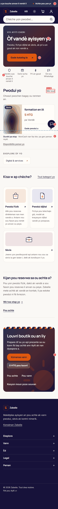 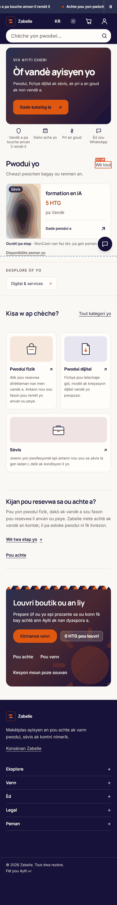

1. Barre d'annonce et en-tête : 145 px, 18 % de l'écran. Le texte défilant est coupé aux deux bords.
2. Titre à 31 px, sous-titre à 13 px : l'écart de hiérarchie est bon, le sous-titre trop petit.
3. CTA en Inter 700 à rayon 12, alors que les autres sont en Manrope 600 à rayon 20.
4. Barre de confiance sur quatre colonnes : la première colonne monte à 4 lignes, les autres à 1 ou 2. Densité inégale.
5. Le bouton WhatsApp recouvre la flèche de la carte.
6. État de MonCash en 12 px sur 2 lignes. V-21 le maintient ; il pèse peu visuellement pour une information qui compte.
7. Bloc vendeur : un dégradé plein et deux pastilles côte à côte (« Kòmanse vann » et « 0 HTG pou louvri ») qui se ressemblent alors qu'une seule est un bouton.

Première visite, en français (pastille 8) : titre sur 2 lignes.

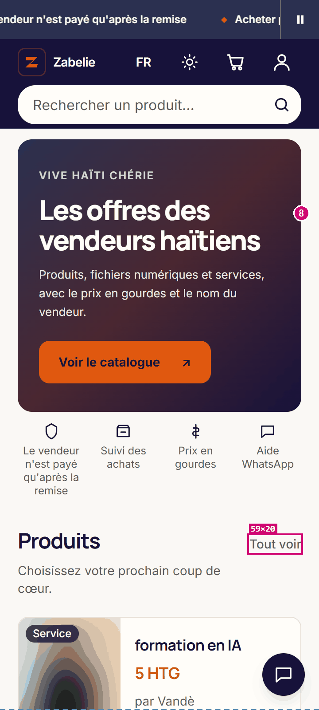

Avec une grille de produits (fixtures, pas de photos) :

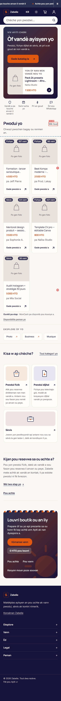

9. La ligne « Gade pwodui a » répète l'action sur chaque carte et ajoute une rangée de texte en 12 px.
10. Avec cinq produits, la cinquième carte laisse un trou à droite.

### Fiche produit

Faux Supabase (produit physique), 360 × 800 et 390 × 844. Production (produit numérique) à droite.

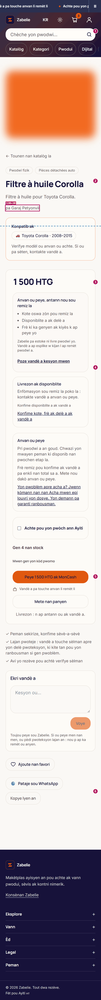 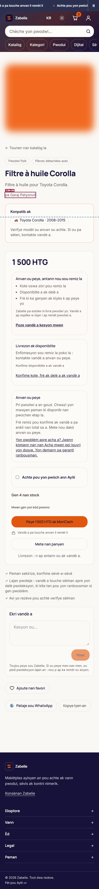 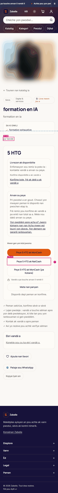

1. En-tête à 202 px, soit 25 % de l'écran.
2. Titre à y = 632 : le premier écran ne montre ni le titre entier, ni le prix.
3. Prix à y ≈ 1 000 (915 sur la fiche réelle).
4. Trois blocs d'information entre le prix et l'action, avec des titres en 14 px qui ressemblent à des libellés.
5. Bouton de paiement à y = 2 020, soit 2,5 écrans plus bas (1 520 sur la fiche réelle).
6. Trois actions secondaires en pastilles de largeurs différentes.
7. Trois moyens de paiement empilés, dont un ou deux à 42 px selon la largeur. Un seul a l'allure d'une action principale : conforme à « un seul CTA primaire ».

### Panier

Faux Supabase (rempli), 360 × 800 et 390 × 844. Production (anonyme) à droite.

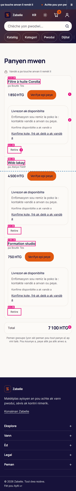 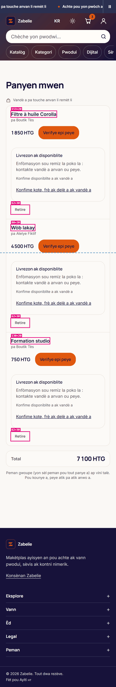 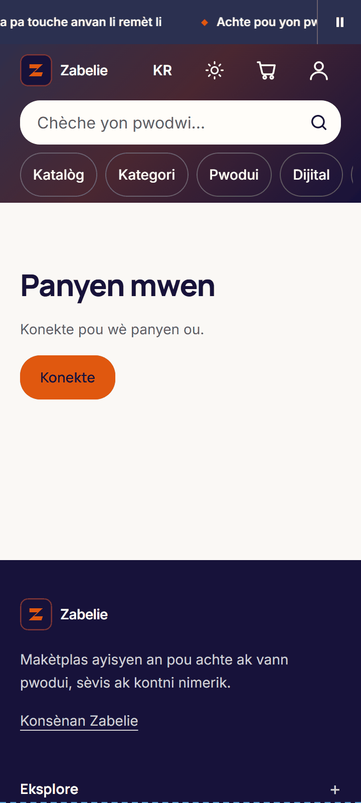

1. Un bouton orange identique par ligne : trois CTA primaires, un par article, parce que le paiement groupé n'est pas ouvert.
2. Le bloc « Livrezon ak disponiblite » se répète trois fois, avec le même texte.
3. « Retire » à 30 px de haut.
4. Le total arrive après tous les articles, sans action associée.

### Connexion et inscription

Production, 360 × 800 et 390 × 844.

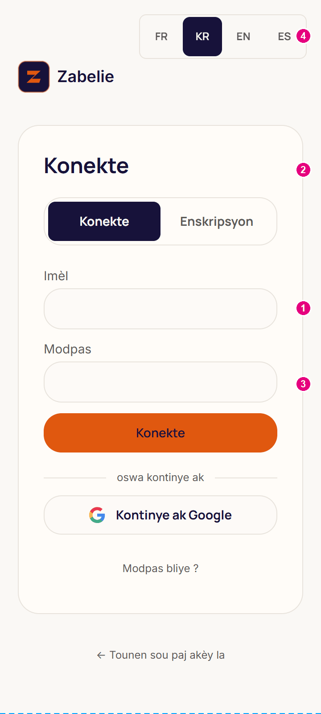 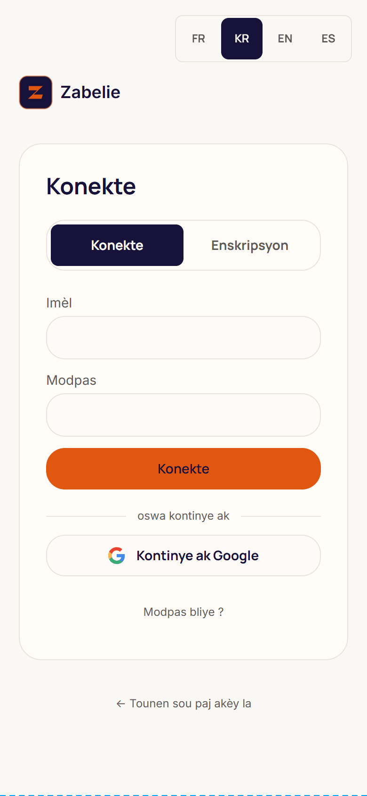 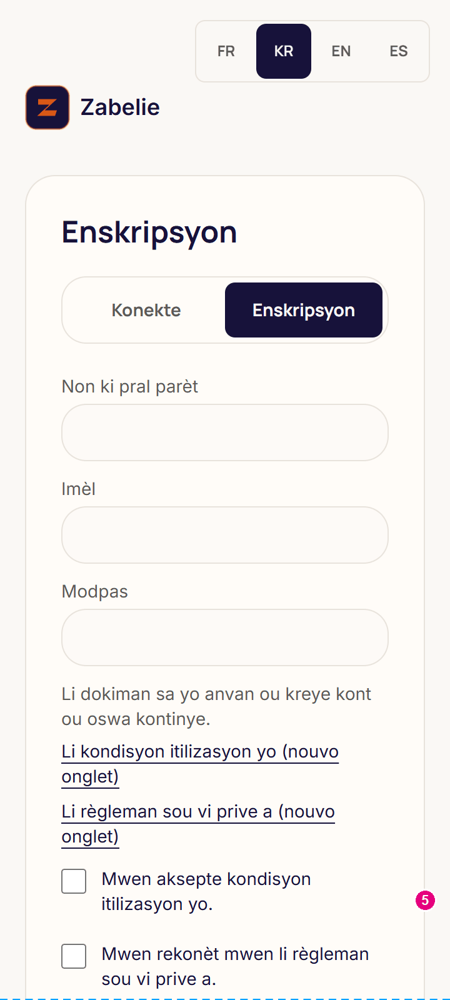 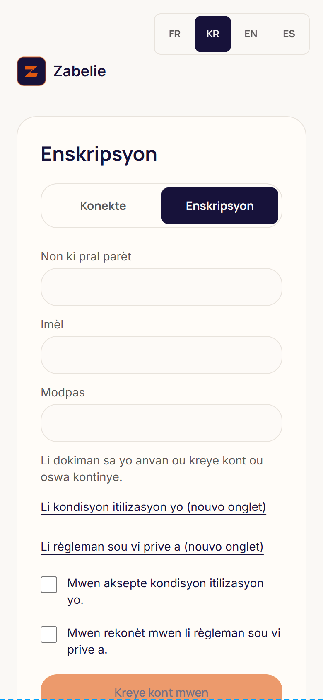

1. Champs à 46 px de haut et texte à 14 px.
2. « Konekte » apparaît en titre, en onglet et en bouton : le titre n'apporte rien.
3. Pas de bascule d'affichage du mot de passe.
4. Le choix de langue passe avant le logo et prend 4 cases de premier niveau.
5. À l'inscription, les deux cases obligatoires poussent le bouton sous le premier écran (y = 813).

### Espace vendeur

Faux Supabase, 360 × 800 et 390 × 844.

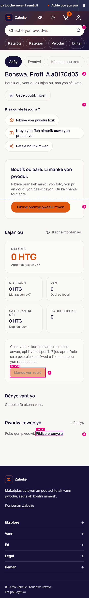 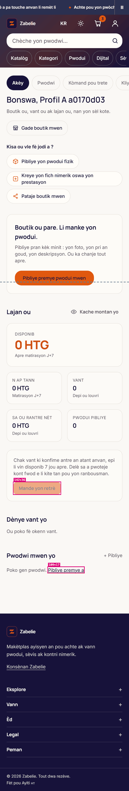

1. En-tête à 202 px, et le menu du vendeur s'y ajoute : `h1` à y = 282.
2. `h1` à 24 / 600, plus faible que les `h1` publics.
3. Trois raccourcis en pastilles de largeurs différentes, dont une sur deux lignes.
4. L'action principale tombe juste sous le premier écran (y = 810).
5. « Mande yon retrè » à 36 px, rayon 8, désactivé et peu lisible.
6. Lien de 17 px de haut, qui répète « + Pibliye » placé juste au-dessus.

### Catalogue et états système

Fixtures et production, 360 × 800.

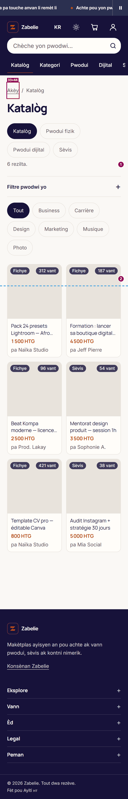 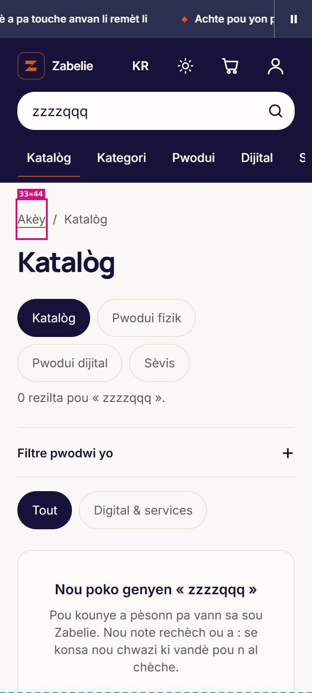 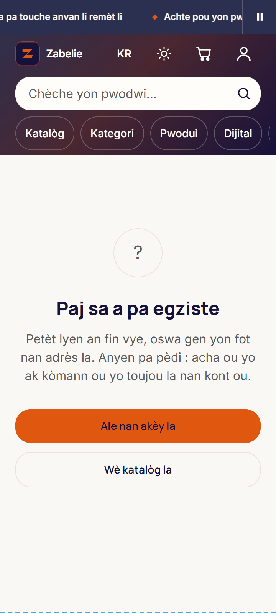

1. Cinq rangées de pastilles de filtre avant le premier produit, avec ces fixtures.
2. Premier produit à y ≈ 740 : aucune carte entière dans le premier écran.

La recherche sans résultat et la page introuvable sont bien tenues : texte en kreyòl, action claire. Leur défaut commun est l'en-tête, à 211 et 202 px.

## Mesures

Lighthouse 12.8.2, mobile, simulé, sur `zabelie.com` en kreyòl. Médiane de 3 passages en 4G lent (RTT 150 ms, 1,6 Mbit/s, CPU ×4), 1 passage en 3G lent (RTT 400 ms, 400 kbit/s, CPU ×4), sauf l'accueil, à 3 passages dans les deux profils.

| Page | Profil | Perf. | Access. | LCP | FCP | CLS | TBT | Poids | JS | Polices |
|---|---|---|---|---|---|---|---|---|---|---|
| Accueil | 4G lent | 88 | 100 | 3 548 ms | 1 383 ms | 0 | 157 ms | 426 Kio | 175 Kio | 75 Kio |
| Accueil | 3G lent | 57 | 100 | 11 442 ms | 3 642 ms | 0 | 479 ms | 424 Kio | 175 Kio | 75 Kio |
| Fiche produit | 4G lent | 75 | 98 | 3 664 ms | 1 254 ms | 0 | 573 ms | 413 Kio | 168 Kio | 75 Kio |
| Fiche produit | 3G lent | 50 | 98 | 11 452 ms | 3 252 ms | 0 | 606 ms | 416 Kio | 168 Kio | 75 Kio |
| Panier | 4G lent | 91 | 100 | 2 269 ms | 1 399 ms | 0 | 268 ms | 305 Kio | 155 Kio | 75 Kio |
| Panier | 3G lent | 67 | 100 | 6 856 ms | 3 656 ms | 0 | 100 ms | 305 Kio | 155 Kio | 75 Kio |
| Connexion | 4G lent | 93 | 100 | 1 678 ms | 1 078 ms | 0 | 291 ms | 363 Kio | 235 Kio | 75 Kio |
| Connexion | 3G lent | 78 | 100 | 4 826 ms | 2 426 ms | 0 | 130 ms | 363 Kio | 235 Kio | 75 Kio |
| Vendre | 4G lent | 72 | 100 | 2 874 ms | 1 260 ms | 0 | 586 ms | 399 Kio | 241 Kio | 75 Kio |
| Vendre | 3G lent | 60 | 100 | 7 648 ms | 4 048 ms | 0 | 281 ms | 400 Kio | 241 Kio | 75 Kio |

Contre-mesure observée (non simulée) : chargement réel bridé par le navigateur, 360 × 800, CPU ×4, médiane de 3 passages.

| Page | LCP 4G lent | FCP 4G lent | LCP 3G lent | FCP 3G lent |
|---|---|---|---|---|
| Accueil | 3 896 ms | 1 740 ms | 15 252 ms | 5 012 ms |
| Fiche produit | 2 552 ms | 1 668 ms | 7 740 ms | 5 036 ms |
| Connexion | 1 660 ms | 1 656 ms | 4 908 ms | 4 908 ms |

Budget du brief face à l'état actuel :

| Mesure | Cible | Aujourd'hui | Verdict |
|---|---|---|---|
| LCP accueil, 3G lent | ≤ 2,5 s | 11,4 s simulé, 15,3 s observé | Hors d'atteinte, voir A10 |
| LCP accueil, 4G lent | (référence du dépôt : ≤ 2,5 s) | 3,5 s simulé, 3,9 s observé | Non tenu |
| CLS | ≤ 0,05 | 0 | Tenu |
| Poids des polices | ≤ 90 Ko | 76,5 Ko, marge de 13,5 Ko | Tenu, voir A3 |
| JS ajouté | ≤ 5 Ko gzip | Base : 155 à 241 Kio selon la page | À comparer à chaque phase |
| Image LCP | `priority`, dimensions explicites | Différée (`lcp-lazy-loaded` en échec), non redimensionnée | Non tenu |

Sur l'accueil en 4G lent, le LCP se décompose ainsi : serveur 633 ms, attente avant le chargement de l'image 1 607 ms, chargement 1 042 ms, rendu 266 ms. L'attente vient de `loading="lazy"` sur l'image la plus visible (`components/card-image.tsx:48`), le chargement du poids de la photo (A11). La référence de 2,77 s (septembre 2026) a été prise sans aucune photo produit : elle ne se compare pas directement.

Deux résultats sont à lire avec prudence. Le `server-response-time` de Lighthouse (11 à 18 ms) n'est pas crédible : `curl` donne 293 ms à 1 021 ms sur cinq essais, je ne le retiens pas. Le LCP de `/vendre` varie du simple au double entre passages (2 007, 2 874, 4 650 ms).

Point de départ des contrôles sur `bfc52fb` : `npm run check:contrast` passe sur toutes les paires, sans opacité interdite ; `tsc --noEmit` ne signale rien ; `npm test` donne 2 768 succès sur 2 769 sous Windows. L'échec, « le cookie n'est lu que par les deux pages qui s'en servent », compare des chemins écrits avec `/` à des chemins Windows en `\` : il vient de la machine de mesure, sans rapport avec ce chantier.

## Liste priorisée

Impact et effort : fort, moyen, faible. Dans chaque phase, l'ordre est celui que je suivrais.

### Phase 1 : fondations

| Amélioration | Impact | Effort |
|---|---|---|
| Échelle de texte par rôle, une seule déclaration du titre et du sous-titre du hero | Fort | Moyen |
| Un seul style de `h1` et de `h2`, à la place de 7 et plus | Fort | Moyen |
| Police d'accent en sous-ensemble, token et test de glyphes (A2, A3) | Fort | Moyen |
| Composant de prix : devise allégée, couleur unique, 70 appels (A1) | Moyen | Moyen |
| Rayons à 3 crans, ombres à 3 niveaux teintés, z-index nommés (A7) | Moyen | Moyen |
| Hex et valeurs en dur ramenés aux tokens, exceptions nommées (A9) | Moyen | Moyen |
| Badge du panier à 12 px, `--radius-button` fantôme retiré | Faible | Faible |

### Phase 2 : composants

| Amélioration | Impact | Effort |
|---|---|---|
| Composant de bouton : 74 écritures vers 3 variantes, `.editorial-button` absorbé | Fort | Moyen |
| Composant de champ : 48 px, 16 px, erreur texte et icône, constantes locales remplacées | Fort | Moyen |
| Carte produit : prix mis en avant, ligne « Gade pwodui a » retirée | Fort | Faible |
| Un seul habillage d'en-tête au lieu de deux | Moyen | Faible |
| Cibles sous 44 px de la liste ci-dessus | Moyen | Faible |
| États : `min-h-11` sur « réessayer », vérification du hors-ligne, états vides homogènes | Moyen | Moyen |
| Icônes : un seul trait, un seul jeu | Faible | Faible |

### Phase 3 : accueil

| Amélioration | Impact | Effort |
|---|---|---|
| Hero : titre, mot d'accent, sous-titre à 16 px, CTA unifié (A5, A13) | Fort | Moyen |
| Première image sans `lazy`, photo redimensionnée (A11) | Fort | Faible |
| Ordre mobile et barre de confiance à hauteur égale (A14) | Fort | Moyen |
| Barre d'annonce : texte non coupé, hauteur réduite | Moyen | Faible |
| Preuve sociale et carte vedette sous seuil (A15) | Moyen | Moyen |
| Accent d'identité discret, sans ajouter à l'existant de V-22 | Moyen | Faible |

### Phase 4 : parcours

| Amélioration | Impact | Effort |
|---|---|---|
| Fiche produit : prix et paiement remontés, `<main>` ajouté (A20) | Fort | Moyen |
| Panier : blocs dédoublonnés, hiérarchie des trois boutons, « Retire » à 44 px (A18) | Fort | Moyen |
| Navigation inférieure et sort du bouton flottant (A19) | Fort | Moyen |
| Connexion : bascule du mot de passe, focus, titre utile, langue déplacée | Moyen | Faible |
| Espace vendeur : `h1`, raccourcis, action principale dans le premier écran | Moyen | Moyen |
| Signaux de confiance près du paiement (texte soumis, A13) | Moyen | Faible |

### Phase 5 : vérification

| Amélioration | Impact | Effort |
|---|---|---|
| Hiérarchie des titres du catalogue (`h1` → `h3`), lien d'évitement partout | Moyen | Faible |
| TBT de la fiche et de `/vendre` (près de 600 ms en 4G lent), 235 Kio de JS sur la connexion : à signaler, hors chantier design | Moyen | Fort |
| Kreyòl : `pwodui` ou `pwodwi`, catégories non traduites, relecture native | Moyen | Faible |
| `DESIGN-SYSTEM.md`, règles dans `CLAUDE.md`, rapport final avant et après | Moyen | Faible |

## Gardes que ce chantier devra faire évoluer

Ces tests échoueront si le brief est appliqué tel quel. Chaque changement se fera dans la même pull request que le code, jamais en retirant le contrôle.

| Test | Ce qu'il tient | Touché par |
|---|---|---|
| `tests/palette-resserree.test.ts:50,83` | Deux oranges, ni noir ni blanc purs | A1 |
| `tests/ux-lot-d.test.ts:28` | Crans de rayons, règle écrite dans le thème | A7 |
| `tests/polices-chargement.test.ts:17,23` | Aucune police préchargée, `swap` | A3 |
| `tests/police-inter.test.ts` | Modèle à copier pour le test de glyphes | A3 |
| `tests/theme.test.ts:45,55` | `on-brand` fixe, parité des deux palettes | A4 |
| `tests/home-premium-cards.test.ts:31,49` | Carte carrée, prix en `.numeric` | Phase 2 |
| `tests/home-premium-structure.test.ts:108,115` | Bouton WhatsApp, ordre bannière, confiance, produits | A14, A19 |
| `tests/boutons-typographie.test.ts` | Liens-boutons en `.bouton` ; à étendre à `.editorial-button` | Phase 2 |
| `tests/titres-section.test.ts`, `tests/typo-titres.test.ts` | Style des `h2` de section, famille des titres | Phase 1 |
| `tests/cibles-tactiles.test.ts:71` | En-tête collant et pli | A14, A19 |
| `tests/promesse-vendeur.test.ts`, `tests/accueil-maquette.test.ts` | Pas de promesse sans objet en base | A12, A13, A15 |

Le préambule de `.claude/skills/design-taste-frontend` exclut le tunnel de paiement, `/panier`, `/tableau-de-bord` et les formulaires de son périmètre. Sur ces écrans, je suivrai votre brief sans appliquer ce skill.
