# Phase 1 : fondations, tokens et typographie

Chantier design et typographie. Base : `origin/main` à `bfc52fb`. Décisions : V-25 (`docs/02-DECISIONS.md`), A1 à A9 de `docs/design/AUDIT-0.md`, pris par délégation le 2026-11-07. Mesures du 2026-11-07.

## L'essentiel

Le site a désormais une échelle : un seul style de `h1`, un seul de `h2`, trois rayons, trois ombres, des plans de superposition nommés, et les valeurs en dur des feuilles de l'accueil et de l'en-tête passent par le thème. Le CLS reste à 0, le JS ne bouge pas, le CSS prend 0,7 Kio.

Deux choses ne se voient pas encore à l'écran. La police d'accent est prête et éprouvée, mais aucun titre ne l'emploie avant la Phase 3. Et le texte courant reste majoritairement en 14 px : A6 le fait migrer écran par écran, en phases 2 à 4.

## Critères du brief

| Critère | Résultat | Preuve |
|---|---|---|
| Aucune valeur de style en dur dans les fichiers touchés | Tenu, hors exceptions nommées (A9) | `tests/design-echelles.test.ts` E5 à E8 ; la seule couleur en dur du TSX touché : les logos Google et Microsoft, `components/connexion-form.tsx:69-80` |
| Script WCAG vert | Tenu, sur les deux palettes | `npm run check:contrast` : « Toutes les paires passent, aucune opacité interdite. » |
| Polices ≤ 90 Ko, mesuré | **87 936 octets** avec le mot d'accent, 76 524 sans | Réponses réseau au rendu : 3 fichiers avec, 2 sans. `app/layout.tsx:77` |
| CLS inchangé ou meilleur | 0 avant, 0 après, sur les trois pages | Tableau ci-dessous |

Aucun fichier sous `app/api`, `supabase/migrations`, ni du paiement, de MonCash, du KYC ou des versements. Vérifiable par :

```bash
git diff --stat origin/main...HEAD -- app/api supabase/migrations app/paiement app/rechaj app/facture app/admin/kyc app/admin/paiements-vendeurs components/buy-button.tsx components/kyc-form.tsx components/payout-queue.tsx components/cart-pay-all.tsx components/business/invoice-editor.tsx
```

## Mesures avant et après

Mêmes conditions des deux côtés : deux builds de production sur cette machine, `origin/main` et cette branche, données de démonstration, Lighthouse 12.8.2 mobile en 4G lent simulé, médiane de 3 passages entrelacés. Ces chiffres ne se comparent pas à ceux de l'audit, pris sur `zabelie.com`.

| Page | LCP | FCP | CLS | TBT | JS | CSS | Polices | Access. |
|---|---|---|---|---|---|---|---|---|
| Accueil | 2 894 → 2 892 ms | 1 534 → 1 524 ms | 0 → 0 | 145 → 131 ms | 179 → 179 Kio | 20,3 → 21,0 Kio | 76 → 76 Kio | 100 → 100 |
| Fiche | 2 912 → 2 975 ms | 1 530 → 1 532 ms | 0 → 0 | 96 → 95 ms | 171 → 171 Kio | 16,2 → 16,9 Kio | 76 → 76 Kio | 98 → 98 |
| Connexion | 2 859 → 2 875 ms | 1 517 → 1 515 ms | 0 → 0 | 80 → 55 ms | 238 → 237 Kio | 16,2 → 16,9 Kio | 76 → 76 Kio | 100 → 100 |

Les écarts de LCP, 63 ms au plus, restent dans le bruit de la mesure. L'accessibilité de la fiche reste à 98 : son `<main>` manquant relève de A20, en Phase 4.

Rendu à 360 px, mesuré par le même instrument qu'à l'audit :

| Mesure | Avant | Après |
|---|---|---|
| `h1` (taille / graisse) | 36/800, 32/800, 31/800, 30/800, 24/800, 24/700 selon l'écran | **28/800 partout**, 36/800 sur le hero |
| `h2` | 24/700, 22/700, 22/600, 20/700, 18/700, 14/700, 14/600 | **20/700** (24 px en grand écran), et 16/700 pour un encadré compact |
| Tailles rendues sur l'accueil | 9 | 6 |
| Sous-titre du hero | 13 px | 16 px |
| Texte de l'accueil à 15 ou 16 px | 0 % | 6 % (A6 se poursuit en phases 2 à 4) |
| Bas du CTA du hero, kreyòl / français | 369 / 424 px | 428 / 494 px, sous les 640 px exigés |
| Bas du CTA, bannière de lancement | non mesuré à l'identique | 514 px en kreyòl et en français, 473 px en anglais et en espagnol |

Le titre du hero tient sur 2 lignes en kreyòl, 3 en français. La bannière de lancement, plus longue, prend 3 lignes en kreyòl et en français, 2 en anglais et en espagnol. Ce sont les nombres annoncés par A5.

## Ce qui change à l'écran

Accueil, kreyòl puis français :

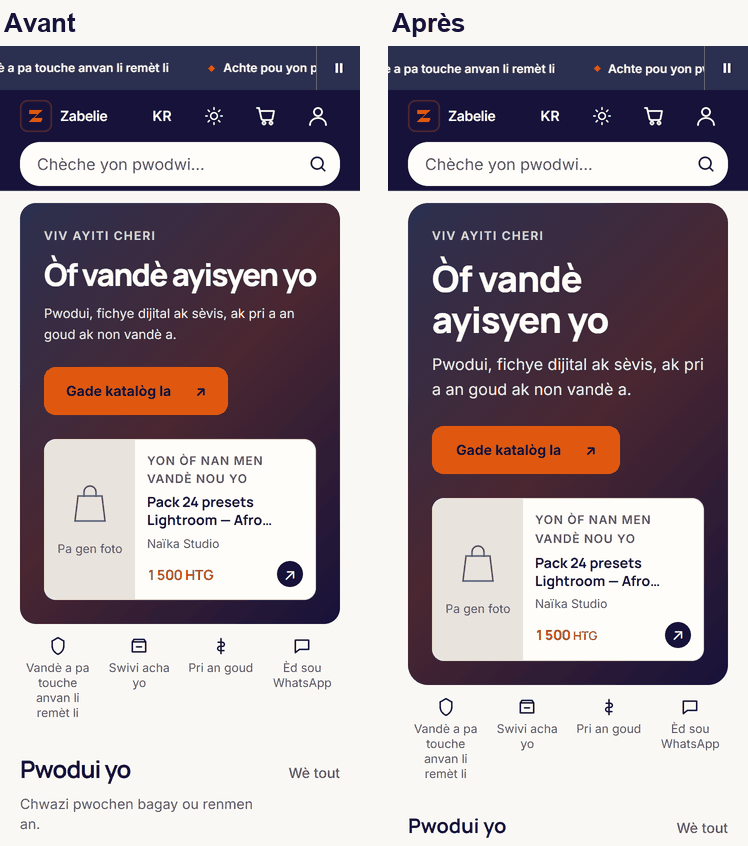 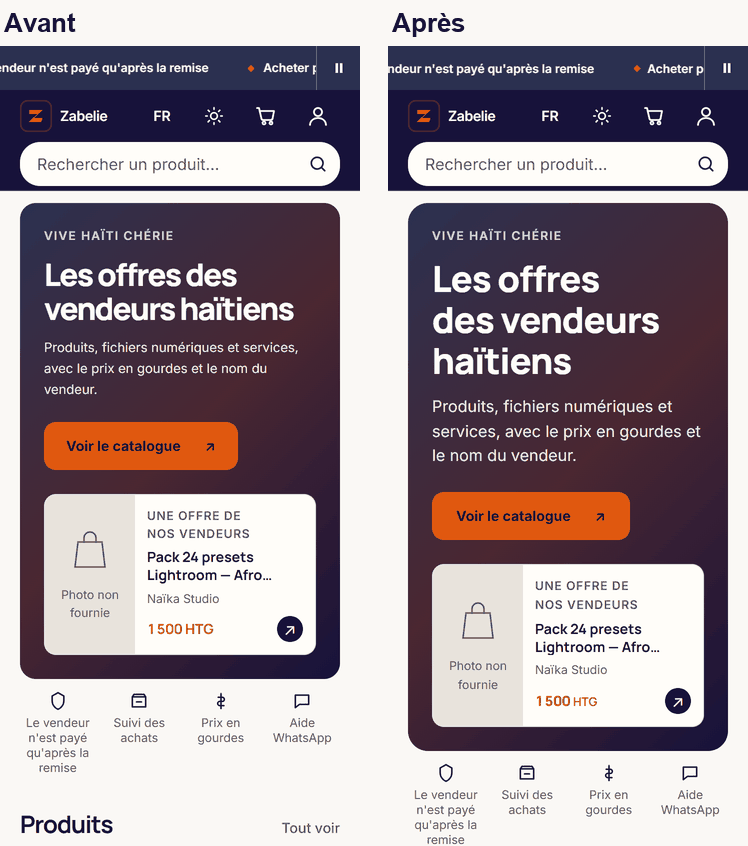

Fiche et `/vendre` :

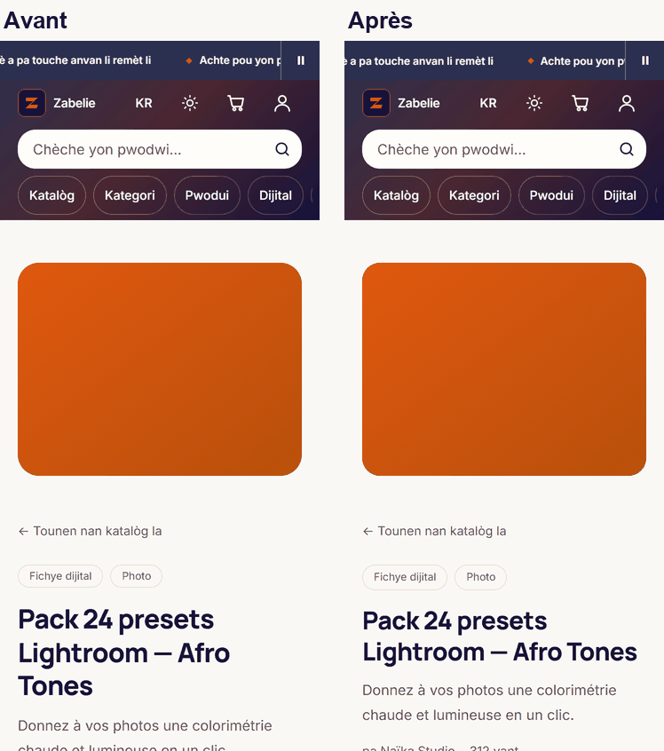 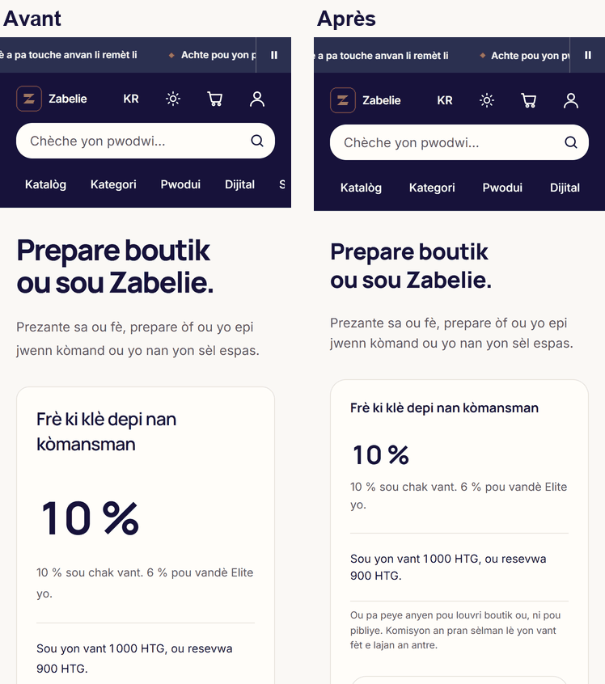

Catalogue et connexion :

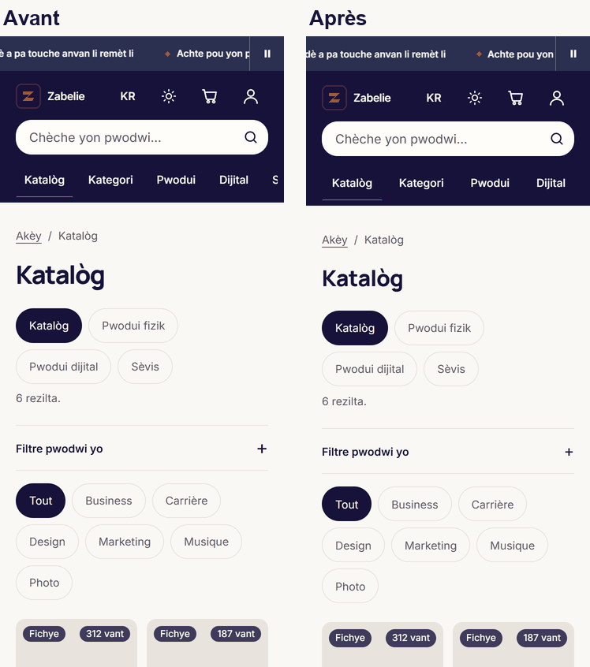 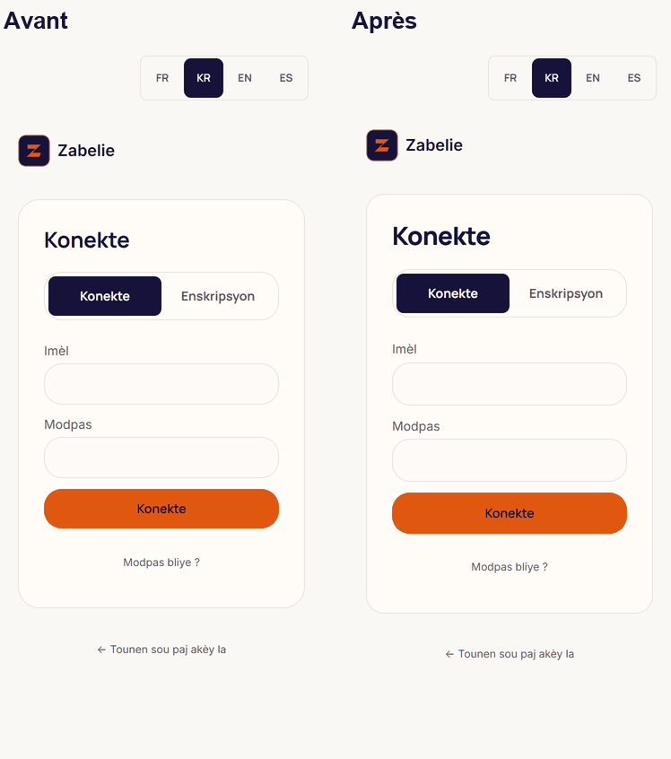

Après seulement : bannière de lancement, tableau de bord vendeur et panier rempli, ces deux derniers sur le faux Supabase des tests E2E, données fictives.

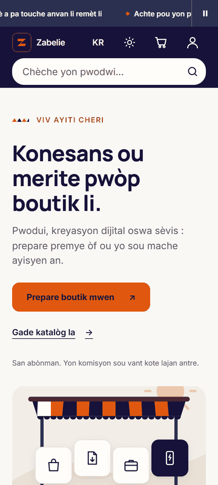 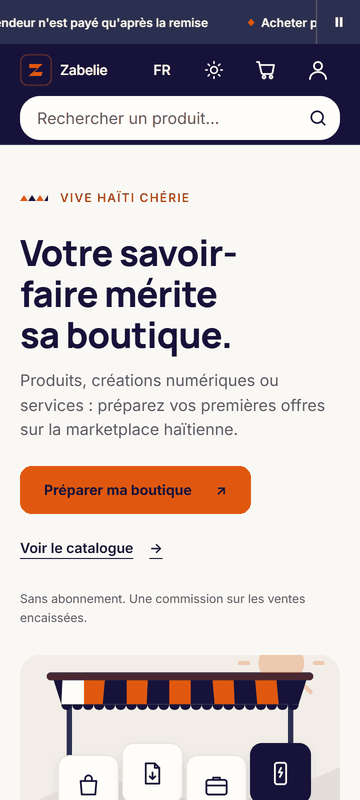 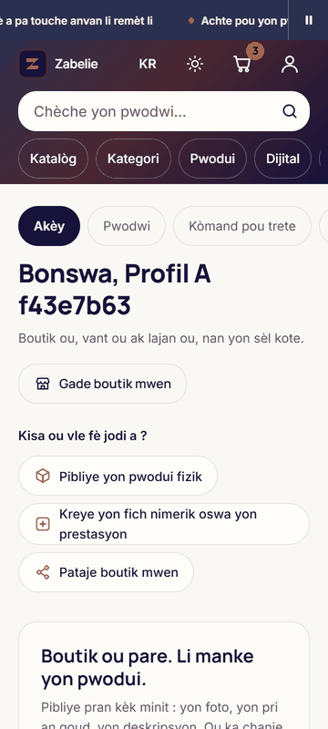 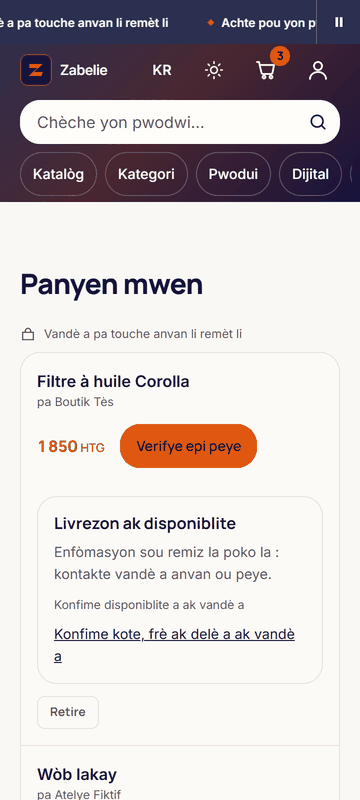

Essai de la police d'accent, posé dans la page le temps de la capture et absent du code livré : `pwòp` en Instrument Serif Italic.

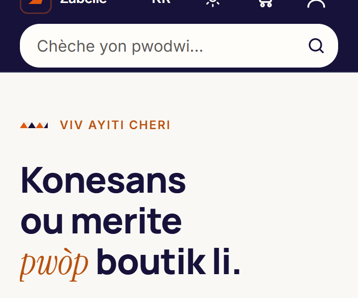

## Ce qui a été fait

**Échelle de texte** (`app/zabelie-theme.css:191-218`). `--text-xs` à `--text-xl` fixes, `--text-2xl` à `--text-4xl` et `--text-display` fluides entre 360 et 1 024 px, en `rem`. Interlignes 1,15, 1,25 et 1,55, interlettrage −0,02em.

**Police d'accent** (`app/layout.tsx:77`, `app/zabelie-theme.css:182`, `.mot-accent` en `app/globals.css:230`). Instrument Serif Italic, 11 412 octets, reproductible par `scripts/decouper-police-accent.sh`, licence OFL à côté du fichier. Sur le rendu : sans mot d'accent, le navigateur ne la télécharge pas. Avec, les 6 essais dans les 4 langues sont dessinés par elle. Le basculement décale le mot de 4 px au plus et ne change pas la hauteur du titre, grâce au repli ajusté (`size-adjust` 88,77 %).

**Titres** (`app/globals.css:40,45`). 157 classes de taille ou de graisse retirées dans 71 fichiers. Le titre et le sous-titre du hero n'ont plus qu'une déclaration, `app/home-discovery.css:22-23`, contre cinq chacun.

**Prix** (`components/prix.tsx:17`, `.prix` en `app/globals.css:192`). Manrope 800, chiffres tabulaires, `--color-accent`, devise allégée qui ne descend pas sous 12 px. Posé sur la carte, la carte vedette, la vente flash, l'offre, le panier et la fiche. Le texte lu reste celui de `formatHTG` au caractère près.

**Rayons, ombres, plans** (`app/zabelie-theme.css:229,237,288`). 146 classes `rounded-2xl` et `rounded-3xl` migrées. `shadow-xl` devient `shadow-lg`, teinté indigo, avec sa valeur sombre (`:358`). Les `z-50`, `z-40`, `z-10` et `z-[60]` deviennent `z-(--z-*)`. Trois éléments montent d'un rang, à dessein : le lien d'évitement, la notification « en ligne » de l'administration et le bandeau des pixels vendeur passent devant l'en-tête.

**Valeurs en dur**. 132 espacements, 38 tailles, 22 rayons et 7 interlignes des six feuilles de l'accueil et de l'en-tête passent par le thème. Les décors de l'accueil et de l'étal lisent `--color-decor-*` (`app/zabelie-theme.css:132`), couleurs d'image fixes dans les deux thèmes. Le violet hors palette de la carte d'administration devient `--color-info`. `--radius-button`, jamais défini, est retiré. Le badge du panier passe de 11 à 12 px.

## Écarts au brief, à relire

1. **Deux styles de `h2`, pas un.** Un `h2` d'encadré compact (pied de page, « Livrezon ak disponiblite ») porte `.titre-bloc`, 16 px : à 20 px il écraserait son encadré, à 14 px il se lisait comme un libellé. Ce sont souvent des `h3` qui s'ignorent, à revoir en Phase 5 avec la hiérarchie.
2. **Les petits crans ne sont pas en `clamp()`.** Un 14 px qui varierait selon l'écran ne serait plus un 14 px. Seuls les crans à partir de `2xl` sont fluides, et un `h1` vaut 28 px sur mobile, 30 px en grand écran.
3. **Les espacements hors grille passent au cran voisin** : 10 devient 12, 14 devient 16, 18 devient 20. Quelques pixels de plus par endroits, d'où la hauteur du hero. Vérifié aux captures, sans débordement à 360 ni à 390 px.
4. **`<Prix>` ne couvre pas les 70 appels de `formatHTG`.** Il est posé là où un acheteur décide. Les montants dans une phrase, les prix barrés, l'historique, l'administration et le chemin de l'argent gardent `formatHTG`.
5. **Le prix change de couleur sur la fiche et dans le panier** : encre avant, orange de texte après. C'est la règle « orange pour CTA et prix » appliquée partout.

## Hors chantier, donc inchangé

Conformément à l'invariant 8 du brief, ces fichiers n'ont pas été modifiés : `app/paiement/**`, `app/rechaj/**`, `app/facture/**`, `app/admin/kyc/**`, `app/admin/paiements-vendeurs/**`, `components/buy-button.tsx`, `components/kyc-form.tsx`, `components/payout-queue.tsx`, `components/cart-pay-all.tsx`, `components/business/invoice-editor.tsx`.

Leurs rayons suivent sans y toucher, le thème faisant valoir `rounded-2xl` comme `rounded-xl`. Leurs `h1` restent en revanche à 24 px, contre 28 px ailleurs. L'écart est visible entre une fiche et la page de confirmation de paiement. Il suffirait de retirer deux classes, mais c'est un geste sur le chemin de l'argent : je ne le ferai que si vous le demandez.

## Ce qui reste

- **Mouvement** : quatre animations des ventes flash dépassent les 300 ms du brief (`app/ventes-flash.css:77,80,81,82`). Elles existaient avant ce chantier, à revoir en Phase 3.
- **Troisième orange** : `#feb56c` dans les images Open Graph (`app/opengraph-image.tsx`, et les deux autres). Ces fichiers restent une exception, puisqu'ils ne peuvent pas lire de variable, mais la valeur mérite d'être ramenée à la palette.
- **Texte courant** : 47 % du texte de l'accueil reste sous 14 px à 360 px (52 % avant). C'est le travail de A6.
- **L'étal** garde son échelle de texte et d'espace, V-23 oblige. Seules ses couleurs, ses ombres et ses deux plans fixes passent par le thème.
- **Cibles sous 44 px** : inchangées, voir la Phase 2.

Non vérifié : téléphone physique, captures en grand écran, e2e sur cette machine (la CI les joue). Mode sombre contrôlé sur l'accueil et la fiche seulement.

## Gardes ajoutées

| Test | Ce qu'il tient | Mutation qui le fait rougir |
|---|---|---|
| `tests/police-accent.test.ts` | Glyphes choisis par la position de l'accent, ni chiffre ni ponctuation, budget, branchement, liste fermée des emplois de `.mot-accent` | Un `.mot-accent` posé dans un composant |
| `tests/titres-role.test.ts` | Aucun style local sur un `h1` ou un `h2`, une seule déclaration du hero, exceptions périmables | `text-lg` sur un `h1` ; seconde déclaration de `.home-headline` |
| `tests/prix.test.ts` | Texte identique à `formatHTG`, classes, posé sur les bons montants | `<Prix>` qui arrondit |
| `tests/design-echelles.test.ts` | Rayons, ombres, plans, valeurs en dur, exceptions périmables, échelle aux bornes justes, tout `var(--…)` cité existe | Une taille en dur ; `#ff6b00` dans un composant ; deux tokens manquants (cas réel, voir plus bas) |
| `tests/tailles-texte.test.ts` (étendu) | Le plancher de 12 px se lit désormais dans le thème | `--text-xs` à 10 px |

Suite complète : 2 798 succès sur 2 799 sous Windows. L'échec, déjà relevé à l'audit, compare des chemins en `/` à des chemins Windows en `\`. `tsc` ne signale rien, ESLint 12 avertissements et aucune erreur.

## Trois instruments qui ont menti pendant ce tour

1. **Une écriture a échoué et le commit est parti quand même.** Le thème a refusé une écriture (`UNKNOWN` sous Windows), deux tokens de l'étal n'ont jamais existé, et rien ne l'a signalé : un `var()` sans valeur ne lève aucune erreur. D'où E10, qui croise chaque citation avec le thème. Il a d'abord rougi sur ces deux tokens-là, puis la correction a suivi (`aa91e6e`).
2. **Un contrôle est devenu aveugle à cause de ce chantier.** `tests/tailles-texte.test.ts` ne lisait que les valeurs littérales et est tombé de 46 à 15 tailles lues. Son témoin l'a signalé. Il résout maintenant les tokens plutôt que de voir son seuil baissé.
3. **Une mesure venait du mauvais serveur.** Deux serveurs oubliés depuis la Phase 0 écoutaient encore sur les ports 3000 et 3001 avec un `.next` effacé : pages sans CSS, en-tête de 1 620 px. Le port occupé a fait échouer le nouveau serveur et l'ancien a répondu à sa place. Écarté à la lecture du chiffre, arrêté, mesure refaite.

## Pour la suite

Phase 2 (composants) : il me faut A12, les badges. Je recommande de réutiliser `BadgeIdentite` et de n'afficher une mention de remise que si le vendeur l'a déclarée, avec « par le vendeur » dans le libellé.

Phase 3 (accueil) : les deux arrêts fermes, A11 (variable d'image Supabase) et A13 (phrase de promesse de paiement), attendent votre réponse. A10, A14, A15 et A16 aussi.
