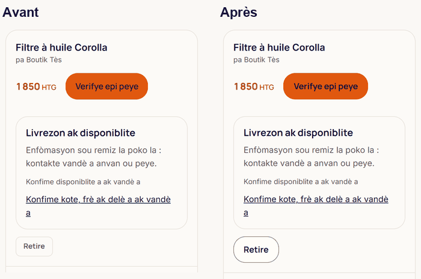
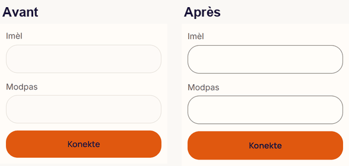
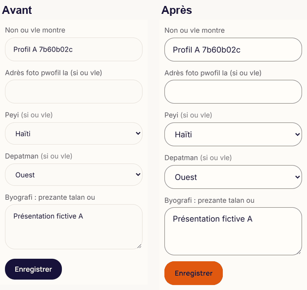
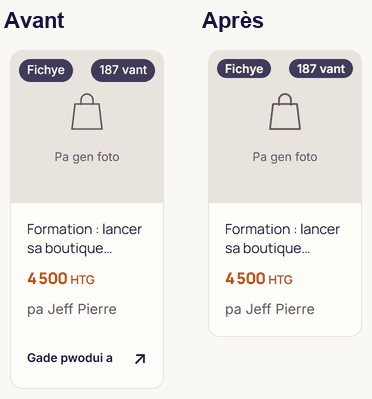
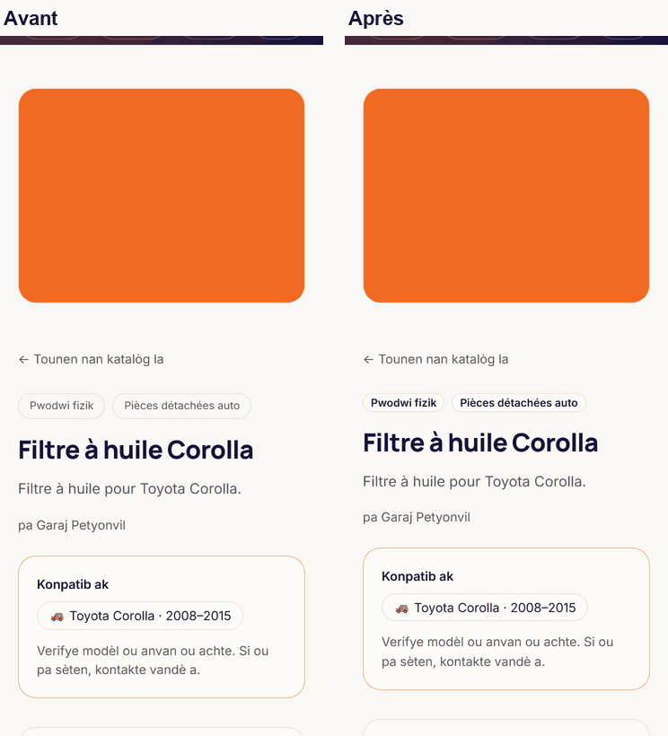
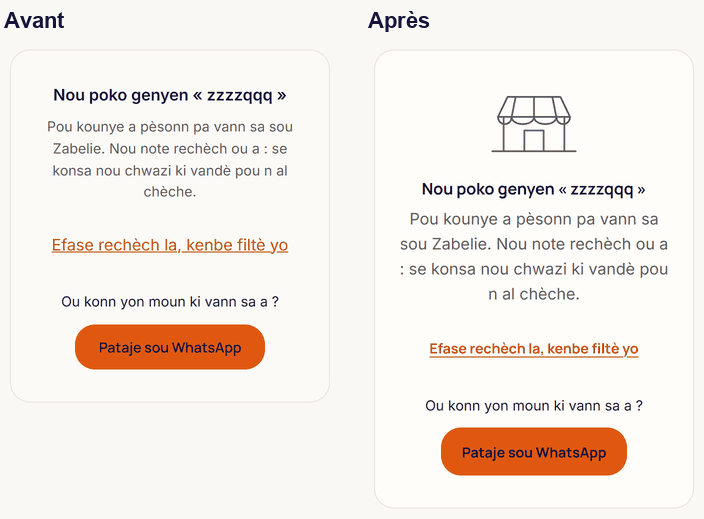
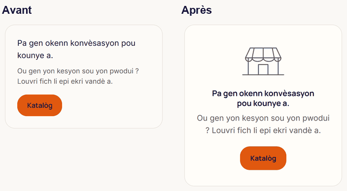

# Phase 2 : composants de base

Chantier design et typographie. Base : la Phase 1, branche `design/typo-phase-1` à `30384c5` (PR #474). Décision : V-26 (`docs/02-DECISIONS.md`), A12 de `docs/design/AUDIT-0.md`, acceptée par Philippe le 2026-11-07. Mesures du 2026-11-07.

## L'essentiel

Les six composants du brief vivent désormais dans le thème, une seule fois : boutons, champs, carte produit, étiquettes, états système, icônes (`app/globals.css:93`, `@layer components`). Le chemin de l'argent n'est pas modifié : il suit le thème sans qu'un de ses fichiers ait bougé.

Ce qui se voit à l'écran : les champs ont un contour visible et leur texte passe à 16 px, 26 champs ont gagné un libellé visible, les erreurs portent une icône, les écrans vides ont un dessin et leur action, « Retire » et les autres petites cibles atteignent 44 px. Le CLS reste à 0, le JS ne grossit pas, le CSS prend 0,5 Kio.

Un chiffre à relire : le temps de blocage de la page de connexion monte de 64 à environ 130 ms, sans module ajouté. L'explication est plus bas.

## Critères du brief

| Critère | Résultat | Preuve |
|---|---|---|
| Tableau avant/après des composants, avec captures | Fait, dix composants | Section suivante, `docs/design/phase-2/` |
| Tous les états testés | Survol, focus, appui, désactivé, chargement (boutons) ; focus, invalide, désactivé (champs) | `tests/boutons-variantes.test.ts` V3, `tests/champs.test.ts` C1 |
| Cibles tactiles ≥ 44 px, vérifiées (liste) | 13 cibles sous 44 px avant, 1 après, sur le chemin des versements | Liste plus bas, mesurée au rendu |
| Aucune régression des tests existants | 2 826 tests sur 2 827 ; le seul échec est l'échec Windows connu | Section « Vérifications » |

Aucun fichier sous `app/api`, `supabase/migrations`, ni du paiement, de MonCash, du KYC, des versements, de la recharge ou des factures. Aucune dépendance ajoutée. Vérifiable par :

```bash
git diff --stat 30384c5..HEAD -- app/api supabase app/paiement app/facture app/rechaj app/admin/kyc app/admin/paiements-vendeurs components/buy-button.tsx components/cart-pay-all.tsx components/cart-pay-button.tsx components/kyc-form.tsx components/payout-queue.tsx components/payout-request.tsx components/payout-form.tsx components/business components/zabelie-topup-form.tsx components/zelle-reference-form.tsx package.json
```

## Les composants, avant et après

Toutes les captures : deux builds de production sur cette machine (la Phase 1 et cette branche), à 360 px, en kreyòl, données fictives du dépôt.

### Boutons

Trois variantes et trois tailles, `app/globals.css:104` à `:202`.

| | Avant | Après |
|---|---|---|
| Écritures | 97 différentes pour 119 fonds orange, plus les contours | `bouton` et une variante : `bouton-primaire` (85 emplois), `bouton-secondaire` (112), `bouton-texte` (11) |
| Hauteurs | de 30 à 48 px selon l'écran (audit Phase 0) | 48 px par défaut, `bouton-compact` 44 px (154 emplois), `bouton-grand` 56 px (2 : l'action principale de l'accueil et de `/vendre`) |
| Contour du secondaire | `--line`, 1,2:1 sur le crème | `--color-contour`, 3,45:1 (`app/zabelie-theme.css:113`, sombre `:361`) |
| Survol | `opacity`, `filter`, couleur, selon le fichier | `opacity` sous `(hover: hover)` (`:152`) |
| Appui | rien, ou `scale(0.97)` à un endroit | `scale(0.97)` en 120 ms (`:170`) |
| Désactivé | opacité 40, 50 ou 60 % | 60 %, et `aria-disabled` pour un lien (`:177`) |
| Chargement | « … » à la place du libellé | `aria-busy` : un point qui bat en opacité, au jeton de 300 ms (`:191`) |
| Typographie | `.editorial-button` en Inter 700 sur le premier bouton du site | Manrope 700 partout, `.editorial-button` absorbé |

Trois boutons à fond sombre (`bg-cloud`) formaient une quatrième variante, dont « Déclarer l'envoi » à 32 px : ils prennent une des trois.



### Champs

`app/globals.css:215` à `:257`.

| | Avant | Après |
|---|---|---|
| Hauteur | 44 à 46 px, moins dans l'administration | 48 px |
| Taille du texte | 14 px pour la plupart (Safari zoome la page au focus) | 16 px |
| Contour | `--line`, 1,2:1 | `--color-contour`, 3,45:1 |
| Anneau de focus | éteint par `outline-none` sur une partie des champs | l'anneau global de 2 px, 4,73:1, et le contour passe à l'accent (`:233`) |
| État invalide | absent | `aria-invalid` : contour `--color-danger` (`:236`) |
| Libellé visible | 26 champs publics nommés pour les seuls lecteurs d'écran | `.libelle` au-dessus du champ (`:251`) |
| Erreur | texte rouge seul, écrit dans chaque formulaire | `MessageErreur` : texte et icône, `role="alert"` (`components/message-erreur.tsx:16`), 41 emplois dans 34 fichiers |
| Clavier et remplissage | `autocomplete` absent sur l'e-mail du mot de passe oublié, le téléphone de livraison, les deux mots de passe de réinitialisation | posés, avec `inputmode` sur e-mail et téléphone |

L'erreur de fourchette de prix du catalogue est reliée à ses deux champs (`app/catalogue/page.tsx:296`, `aria-describedby`).

 

### Carte produit et étiquettes

La carte tenait déjà l'essentiel du brief : image carrée sur un fond, nom sur deux lignes, prix à 16 px, carte entière cliquable, deux colonnes à 360 px. Deux changements :

- la ligne « Gade pwodui a » ne reste que sur la carte de boutique, en liste (`components/product-card.tsx:128`). Sur la grille, elle répétait l'action de la carte entière, en 12 px ;
- les étiquettes passent par `.etiquette` (`app/globals.css:277`), deux tons qui ne prennent jamais l'orange. « Identité vérifiée » les reprend (`components/badge-identite.tsx:16`), comme les étiquettes de la fiche (`app/produit/[slug]/page.tsx:386`). Le délai d'un service n'est plus en orange de texte.

V-26 : ni « Vendeur vérifié » ni « Livraison locale ». Deux étiquettes au plus par carte, tenu par `tests/carte-produit.test.ts`.

 

### États système

- **État vide** : `EtatVide` (`components/etat-vide.tsx:15`) reprend le dessin de l'étal vide qui ouvrait le catalogue, en gris et au trait des icônes, puis le titre, le texte et l'action de chaque écran, traduits chez l'appelant. Douze états sur six écrans : catalogue (sept), panier, messages, achats, favoris, boutique. Avant : six mises en forme, un seul dessin, en orange.
- **Erreur réseau** : la reprise existait, « Eseye ankò » dans les quatre langues. Elle passe en bouton principal, à 48 px (`app/error.tsx`, `components/bouton-reessayer.tsx`).
- **Squelettes** : ils battaient déjà en opacité et s'arrêtent en mouvement réduit. Leur forme suit la carte sans la ligne retirée.

 

### Icônes

`Icone` (`components/icone.tsx:20`) : 16, 20 ou 24 px, trait de 1,75 px en pixels d'écran (`vector-effect: non-scaling-stroke`, `app/globals.css:339` et `:347`). Avant : 38 SVG en ligne, trois jeux, sept épaisseurs de 1,5 à 2,5, et un trait qui maigrissait avec l'icône (2 sur une grille de 24 rendait 1,33 px à 16 px). 32 emplois, dont les jeux des rayons et du studio. Restent en SVG brut, nommés dans `tests/icones.test.ts` : illustrations, cartes, logo, logos OAuth, éclair des ventes flash, « Ouvrir ma boutique », chemin de l'argent.

## Cibles tactiles, mesurées au rendu

Même sonde avant et après, à 360 px, éprouvée au démarrage sur une page jetable (une cible de 30 px et une de 44, un fond orange au-dessus du pli et un en dessous).

| Écran | Cible | Avant | Après |
|---|---|---|---|
| Accueil | « Wè tout » | 52 × 22 | 44 de haut |
| Catalogue, recherche | « Akèy » (fil d'Ariane) | 33 × 44 | 45 × 44 |
| Fiche produit | Nom du vendeur | 120 × 22 | 44 de haut |
| Panier | Nom du produit, ×3 | 80 à 153 × 20 | 44 de haut |
| Panier | « Retire », ×3 | 62 × 33 | 44 de haut |
| Profil de boutique | Lien de la boutique | 278 × 43 | 44 de haut |
| Profil de boutique | « Enregistrer » | 115 × 42 | 48 de haut |
| Espace vendeur | « Mande yon retrè » | 142 × 38 | **inchangé** : chemin des versements |
| Espace vendeur | « Pibliye premye a » | 109 × 17 | inchangé : lien dans une phrase, exempté par WCAG 2.5.8 |

Mesures par écran, avant → après (les champs comptés hors recherche de l'en-tête, exception nommée) :

| Écran | Cibles < 44 px | Fonds orange au premier écran | Champs sous 16 px |
|---|---|---|---|
| Accueil | 1 → 0 | 1 → 1 | |
| Catalogue, recherche vide | 1 → 0 | 0 → 0 | |
| Connexion, inscription | 0 → 0 | 1 → 1 | 5 sur 5 → 0 |
| Mot de passe oublié | 0 → 0 | 1 → 1 | 1 sur 1 → 0 |
| Panier | 6 → 0 | 1 → 1 | |
| Fiche physique | 1 → 0 | 0 → 0 | |
| Profil de boutique | 2 → 0 | 1 → 1 | 5 sur 5 → 0 |
| Espace vendeur | 1 → 1 | 0 → 0 | |
| Messages, achats, profil, introuvable, hors ligne | 0 → 0 | 1 → 1 | |

« Un seul CTA primaire visible par écran » : tenu sur les dix-sept écrans mesurés, avant comme après. Le panier en a un par article, plus bas que le premier écran : A18, en Phase 4.

## Performance, mêmes conditions

Deux builds de production, données de démonstration, Lighthouse 12.8.2 mobile en 4G lent simulé, médiane de 3 passages entrelacés.

| Page | LCP | TBT | JS | CSS | CLS | Access. |
|---|---|---|---|---|---|---|
| Accueil | 2 886 → 2 874 ms | 157 → 154 ms | 179,5 → 178,7 Kio | 21,0 → 21,5 Kio | 0 → 0 | 100 → 100 |
| Fiche | 2 975 → 2 883 ms | 98 → 98 ms | 171,3 → 170,5 Kio | 16,9 → 17,4 Kio | 0 → 0 | 98 → 98 |
| Connexion | 2 872 → 2 874 ms | **64 → 147 ms** | 237,9 → 236,6 Kio | 16,9 → 17,4 Kio | 0 → 0 | 100 → 100 |

Polices inchangées. JS ajouté par la phase : aucun, la mesure baisse de 1 Kio.

**Le TBT de la connexion.** Six passages de chaque côté : 56 à 139 ms avant (médiane 64), 119 à 210 ms après (médiane 134). La hausse est donc réelle à la mesure. Elle ne vient pas d'un ajout de code : les fichiers JS servis sont les mêmes à l'octet près, renommés par le build. Ce qui change, c'est l'ordre : le fichier de 194 Ko s'exécute 300 ms plus tôt, avant l'autre gros fichier, et les tâches longues se regroupent autrement (`long-tasks` de Lighthouse, passages 1 et 4). Le travail de style et de mise en page monte aussi d'environ 13 ms réels (52 ms simulés). Je ne l'ai pas corrigé : la cause est l'ordonnancement du build, pas le design, et la Phase 5 porte la performance. À surveiller.

## Écarts au brief, à relire

1. **Trois tailles, mais la plus fréquente est la compacte.** 154 boutons en 44 px, parce que la plupart sont des actions de liste dans les tableaux de bord. Le défaut à 48 px sert les formulaires, où il s'aligne sur les champs.
2. **Champs sans libellé visible, nommés** (`tests/champs.test.ts`, `SANS_LIBELLE_VISIBLE`) : l'administration interne ; les champs de recherche à loupe ; le filtre de zone du catalogue, dont la rangée a un libellé visible (« Zòn ») et dont chaque liste se nomme par sa première option ; la compatibilité véhicule, écrite en français sans clé i18n, à traduire en Phase 4.
3. **La recherche de l'en-tête reste à 44 px**, hors `.champ` : c'est une pilule dans une barre collante, à revoir avec l'en-tête (A19, Phase 4). Elle retrouve son anneau de focus.
4. **Pas de badge « Nouveau »** : il faudrait un seuil d'ancienneté qui n'existe pas (V-26).
5. **Le délai d'un service** reste affiché sans « par le vendeur » (« Livrezon nan {days} jou ») : c'est un délai de prestation, pas une remise. V-26 le laisse ouvert.
6. **La couleur d'icônes et de pastilles orange** hors bouton et prix demeure : icônes des raccourcis du tableau de bord, barre de confiance, compteurs du panier et des messages, onglet actif de « Mes achats ». Ce sont des décisions de palette (V-22), pas des composants : je ne les ai pas changées.

## Hors chantier, donc inchangé

Le chemin de l'argent : boutons d'achat, de paiement groupé et de versement, formulaires KYC, recharge, factures. Leurs boutons gardent leur écriture à la main, que `tests/boutons-variantes.test.ts` V4 compte comme témoin. La Phase 4 autorise une retouche de présentation du checkout : elle se fera là, fichier par fichier.

## Ce qui reste

- « Mande yon retrè », 38 px, sur le chemin des versements (Phase 4, avec votre accord).
- Le TBT de la connexion, à suivre en Phase 5.
- Les transitions de couleur de `.editorial-link` et de la grille des univers (`app/editorial-marketplace.css`), hors de la règle « transform et opacity » : Phase 5.
- La migration du corps à 16 px (A6) : faite pour les champs et les états vides, à poursuivre écran par écran en phases 3 et 4.

## Gardes ajoutées

| Test | Ce qu'il tient |
|---|---|
| `tests/boutons-variantes.test.ts` | V0 à V7 : tailles, variantes, états, aucune transition hors `transform` et `opacity`, aucun bouton orange, à contour ou à fond sombre écrit à la main hors chemin de l'argent, aucune variante sans sa base |
| `tests/champs.test.ts` | C0 à C6 : 48 px et 16 px, contour, anneau, libellé visible non vide, `autocomplete` et `inputmode`, erreur en texte et icône |
| `tests/carte-produit.test.ts` | K1 à K4 : carte cliquable entière, deux étiquettes jamais orange, la ligne retirée de la grille, aucune « livraison locale » dans quatre langues |
| `tests/etats-systeme.test.ts` | S1 à S4 : état vide sans chaîne à lui, emplois, reprise après erreur, squelette |
| `tests/icones.test.ts` | I1 à I4 : trois tailles, trait fixe, aucun SVG brut ni trait local hors exceptions nommées |
| `tests/helpers/` | `chemin-argent.ts` (liste partagée), `cible-tactile.ts` (ce qui déclare 44 px), `balises-jsx.ts` (balises lues accolades équilibrées) |

Chaque garde a été éprouvée par mutation, 30 en tout, chacune vue par le contrôle attendu, et la restauration vérifiée à l'octet près.

Dix-sept fichiers de tests existants cherchaient `min-h-11`, un `aria-label`, un `role="alert"` ou un texte indicatif là où il y a désormais une classe, un libellé visible ou `MessageErreur`. Chacun a été réécrit pour tenir la même chose sous sa nouvelle forme, jamais retiré. Les sept tests de la réinitialisation du mot de passe trouvent désormais leurs champs par leur libellé visible ; ce qu'ils vérifient n'a pas bougé.

## Trois instruments qui ont menti pendant ce tour

1. **Mes éditions en Python ont converti 19 fichiers en CRLF.** Sous Windows, Python relit en `\n` et réécrit en `\r\n`. Deux tests sont tombés sur des ancres introuvables, ce qui m'a mis sur la piste. Pire : mon script de mutation avait le même défaut, et son « restauré : True » comparait du texte déjà normalisé, donc il ne pouvait pas le voir. Les 19 fichiers sont revenus en LF, le script écrit et compare désormais à l'octet.
2. **Mon motif de balise coupait au `>` d'une flèche.** `<button((?:[^>]|=>)*?)>` s'arrête sur le `>` d'un `onClick={() => …}` posé avant `className` : 40 boutons ont échappé à la première passe. Le découpeur de `tests/helpers/balises-jsx.ts` équilibre accolades et guillemets, et la garde V7 lit la chaîne de classes, pas la balise. Le test existant `tests/boutons-typographie.test.ts` porte le même motif : je ne l'ai pas changé, je le signale.
3. **Deux serveurs fantômes ont encore répondu.** L'arrêt de mes serveurs en a laissé deux debout sur les ports 3000 et 3004, invisibles à `netstat` dans mon environnement. Les nouveaux n'ont pas pu démarrer (`EADDRINUSE`), et la mesure a lu un ancien build qui citait une feuille de style absente. Je l'ai vu aux chiffres (des dizaines de petites cibles d'un coup), confirmé par une erreur 500 sur la feuille, et retrouvé les processus par leur ligne de commande. Toutes les mesures de ce rapport ont été refaites après.

Et deux chiffres faux dans mes messages de commit, corrigés ici : 26 champs ont reçu un libellé visible (le commit dit 23), et il y a 12 états vides (le commit dit onze).

## Vérifications

`tsc` propre, ESLint sans erreur (12 avertissements, inchangés), contraste vert sur les deux palettes avec la nouvelle paire du contour, 2 826 tests sur 2 827 sous Windows. Le seul échec compare des chemins en `/` à des chemins en `\` (`tests/zone-acheteur.test.ts`), sans rapport avec ce chantier. Non vérifié : téléphone physique, e2e sur la machine locale (la CI les joue).

## Pour la suite

La Phase 3 (hero et accueil) attend deux arrêts fermes, où « sans préférence » ne vaut pas :

- **A11** : activer le redimensionnement des photos Supabase (variable d'environnement, peut-être une dépense) ;
- **A13** : la phrase de promesse de paiement du hero. Je propose celle qui est déjà en ligne, « Vandè a pa touche anvan li remèt li ».

Les autres points de la Phase 3 (A14 à A16) se prennent sur recommandation si vous le souhaitez.
