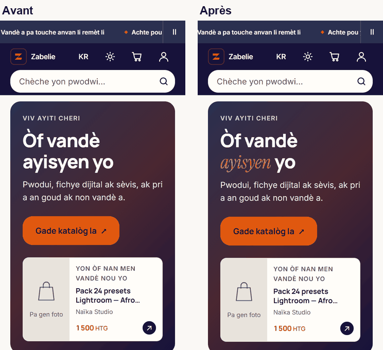
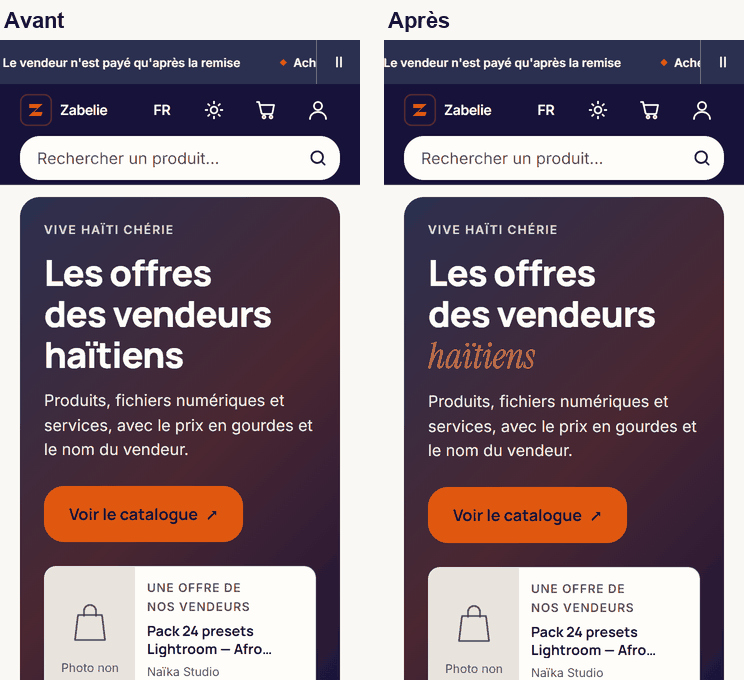
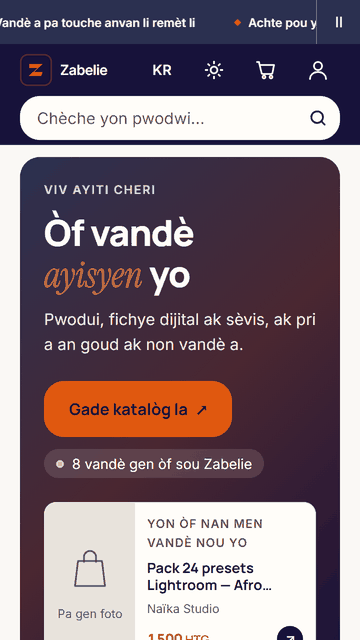

# Phase 3 : hero et page d'accueil

Chantier design et typographie. Base : `main` après la Phase 2 (#475). Décision : V-27 (`docs/02-DECISIONS.md`), prise par délégation le 2026-11-07 (« continuer à travailler »). Mesures du 2026-11-07.

## L'essentiel

Le titre du hero porte désormais son mot d'accent, en serif italique orange, dans les quatre langues, sans qu'aucun texte change. Une pastille de preuve sociale est prête : elle compte les vendeurs réels et ne s'affiche qu'à partir de trois. Il n'y en a qu'un aujourd'hui en production, donc elle n'apparaît pas. Les sections de l'accueil sont espacées sur un rythme unique.

Ce qui ne bouge pas, et pourquoi : le sous-titre de paiement (A13) et le chargement des photos (A11) sont des arrêts fermes, et l'ordre mobile (A14) dépend d'A13. Ces trois points attendent votre réponse.

Un défaut trouvé en route, et corrigé : le mot d'accent, dans l'orange de texte du thème, rendait 2,55:1 sur l'indigo de la bannière, sous le 3:1 exigé pour un grand texte. Le script de contraste ne pouvait pas le voir.

À relire : la police d'accent coûte environ 100 ms de LCP en simulation, et la cible de 2,5 s n'était déjà pas tenue avant. L'arbitrage est plus bas.

## Critères du brief

| Critère | Résultat | Preuve |
|---|---|---|
| Capture 360 × 800 avec CTA visible sans défilement | Tenu, bas du CTA entre 437 et 503 px selon la langue, à 360 × 640 | Tableau ci-dessous, `docs/design/phase-3/` |
| LCP ≤ 2,5 s mesuré | **Non tenu** : 2 909 ms avant, 3 009 ms après | Section « Performance » |
| Aucune donnée fictive affichée | Tenu : la pastille compte des vendeurs réels, sans ville | `app/page.tsx:193`, `lib/home-sections.ts:46` |
| Section masquée sous le seuil, test cité | Tenu | `tests/hero-accueil.test.ts` H4 |

Aucun fichier sous `app/api`, `supabase`, ni du chemin de l'argent. Aucune dépendance ajoutée.

## Ce qui a été fait

### Titre à mot d'accent (brief 3.1, V-25 A2)

`TitreAccent` (`components/titre-accent.tsx`) pose un mot en police d'accent dans la chaîne i18n existante. Le titre ne change pas : `launch.title` sert aussi sur « Ouvrir ma boutique », et y glisser une marque de mise en forme l'aurait fait fuir là-bas. Le mot est désigné par une seconde clé, dans les quatre langues :

| Langue | Titre courant | Titre de lancement |
|---|---|---|
| Kreyòl | Òf vandè *ayisyen* yo | Konesans ou merite pwòp *boutik* li. |
| Français | Les offres des vendeurs *haïtiens* | Votre savoir-faire mérite sa *boutique*. |
| Anglais | Offers from *Haitian* sellers | Your skills deserve their own *shop*. |
| Espagnol | Ofertas de vendedores *haitianos* | Tu talento merece su propia *tienda*. |

Un mot introuvable (une traduction modifiée d'un côté seulement) laisse le titre intact et se journalise. Chaque mot n'a que des lettres que porte la découpe de la police, vérifié dans le fichier de police lui-même (H1).

Sur la bannière indigo, le mot prend `--color-accent-sur-chrome` (`app/zabelie-theme.css:109`, sombre `:362`), un orange plus clair : 5,59:1 au plus bas sur les trois arrêts du dégradé, contre 2,55:1 pour l'orange de texte. La bannière de lancement, sur fond clair, garde l'orange de texte (`app/home-discovery.css:27`).

 

### Preuve sociale sous seuil (brief 3.4, V-27 A15)

« {n} vandè gen òf sou Zabelie », dans les quatre langues. Le chiffre est le nombre de vendeurs qui ont une offre publiée parmi celles que charge l'accueil (`app/page.tsx:193`). C'est un plancher, jamais un chiffre gonflé : l'accueil ne charge que les 60 offres les plus récentes. Pas de ville : aucun vendeur n'a déclaré de zone. Sous `SEUIL_VENDEURS` (3, le seuil existant, `lib/home-sections.ts:46`), la pastille n'existe pas, et le hero tient sans elle.

Elle est posée sous le bouton, pour ne jamais le pousser hors du premier écran. Elle n'apparaît dans aucun environnement local, qui n'ont qu'un vendeur identifié, pas plus qu'en production aujourd'hui. Son dessin a donc été jugé sur un rendu **simulé** : la même balise et la même classe, injectées dans la page.

### Rythme vertical (brief 3.7)

40 px entre les sections sur mobile, 48 en grand écran (`pt-10 md:pt-12`, l'échelle Tailwind selon V-25 A8). La rangée principale, qui ouvre le premier écran, garde ses 24 px : l'espacer descendrait les premiers produits sous le pli. « Wè tout » est à droite de chaque titre de rangée, en lien texte, depuis la Phase 2.

## Mesures du hero, à 360 × 640

Même instrument avant et après, police d'accent chargée (`document.fonts`).

| Langue | Lignes du titre | Bas du CTA | Mot d'accent |
|---|---|---|---|
| Kreyòl | 2 → 2 | 436 → 437 px | aucun → *ayisyen* |
| Français | 3 → 3 | 502 → 503 px | aucun → *haïtiens* |
| Anglais | 2 → 2 | 461 → 462 px | aucun → *Haitian* |
| Espagnol | 3 → 3 | 502 → 503 px | aucun → *haitianos* |

Le brief demande deux lignes au plus. Le français et l'espagnol en prennent trois, comme V-25 A5 l'a accepté. La bannière de lancement n'a pas été mesurée : la production n'est pas en mode lancement, puisqu'elle a une offre publiée.

## Performance

Accueil, deux builds de production (Phase 2 et Phase 3), données de démonstration, Lighthouse 12.8.2 mobile en 4G lent simulé, médiane de **5** passages entrelacés.

| Mesure | Avant | Après |
|---|---|---|
| LCP | 2 909 ms | 3 009 ms |
| FCP | 1 680 ms | 1 834 ms |
| Polices | 75,9 Kio | 87,6 Kio (budget 90 Ko tenu) |
| CLS | 0 | 0 |
| Accessibilité | 100 | 100 |

La police d'accent coûte environ 100 ms de LCP et 150 ms de FCP dans la simulation de Lighthouse, qui compte ses 11,7 Kio dans le chemin critique du titre. J'ai essayé `display: optional` sans le commiter. Sur un premier chargement lent, le mot resterait alors dans sa police de repli, sans se redessiner. Résultat : LCP médian de 2 971 ms, FCP inchangé. La simulation compte le fichier quel que soit son mode d'affichage, et je suis revenu à `swap`, la décision A3.

**La cible de 2,5 s n'était pas tenue avant cette phase** (2,9 s en Phase 1 comme en Phase 2). L'élément LCP est le titre, en Manrope ; son retard vient du chargement des polices, pas du design de cette phase. A10 a placé la cible sur ce profil 4G lent.

**Arbitrage, tranché le 2026-11-07 : « Garder l'accent »** (V-27). Les options étaient :

1. Garder le mot d'accent : le brief le demande, et il coûte 100 ms simulées, 11,7 Kio, dans le budget. **Retenue.**
2. Le retirer du titre sur petit écran : on regagnait ces 100 ms, mais on perdait l'identité que le brief cherchait.

Dans les deux cas, les 2,5 s se visent en Phase 5, sur le chargement des polices du titre : préchargement de Manrope, à remesurer, puisque la mesure du 2026-10-17 l'avait retiré pour son coût sur le premier affichage.

## Écarts au brief, à relire

1. **Sous-titre de réassurance (3.2)** : inchangé, A13 est un arrêt ferme.
2. **Ordre mobile (3.8)** : inchangé. L'option recommandée d'A14 descend la barre de confiance sous les produits en confiant la promesse au sous-titre, c'est-à-dire à A13.
3. **Image du hero (A11)** : inchangée. Le chargement différé de la première carte et le redimensionnement des photos restent en l'état.
4. **Preuve sociale sans ville** : « à Cap-Haïtien » supposerait des zones déclarées, et il n'y en a aucune.
5. **Accent d'identité haïtienne (3.6)** : rien d'ajouté. Le décor de l'accueil existe déjà (V-22), et le mot d'accent porte le mot « ayisyen ».
6. **Carte flottante (3.5)** : `components/home-featured.tsx` existait déjà et ne montre une note que si un produit en a une. Je n'y ai pas touché.

## Gardes ajoutées

| Test | Ce qu'il tient |
|---|---|
| `tests/hero-accueil.test.ts` | H1 : le mot d'accent figure une fois dans son titre, dans les quatre langues, en lettres que porte la police. H2 : chaque variante du titre avec son mot. H3 : `TitreAccent` entoure le mot, et un mot absent se journalise. H4 : la pastille est absente sous le seuil, et son chiffre vient du compte. H5 : le rythme des sections. H6 : l'orange du mot sur l'indigo |
| `scripts/zabelie-contrast.mjs` | La paire `--accent-sur-chrome` sur les trois arrêts du dégradé |
| `tests/police-accent.test.ts` | `components/titre-accent.tsx` inscrit comme seul emploi autorisé du mot d'accent |

Huit mutations, chacune vue par le contrôle attendu, dont l'orange trop sombre que le script de contraste refuse.

Deux tests existants réécrits sans être affaiblis : `tests/home-premium-structure.test.ts` S5 suit le titre passé par `TitreAccent`, et S4 garde le helper de seuil tandis que l'espacement passe à H5. Un renvoi mort corrigé : `app/globals.css` citait `tests/mot-accent.test.ts`, qui n'a jamais existé. La garde est `tests/police-accent.test.ts`.

## Vérifications

`tsc` propre, contraste vert sur les deux palettes, 2 832 tests sur 2 833 sous Windows (le seul échec compare des chemins en `/` à des chemins en `\`, `tests/zone-acheteur.test.ts`, sans rapport avec ce chantier). Non vérifié : téléphone physique, e2e local (la CI les joue), bannière de lancement au rendu.

## Pour la suite

- **A13** : la phrase du sous-titre. Je propose celle qui est déjà en ligne, « Vandè a pa touche anvan li remèt li ». Elle débloque A14.
- **A11** : le redimensionnement des photos, une variable d'environnement.
La Phase 4 (connexion, parcours et checkout en présentation seulement) peut démarrer sans eux.
