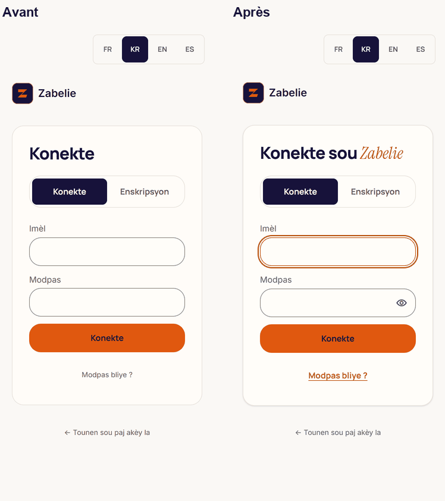
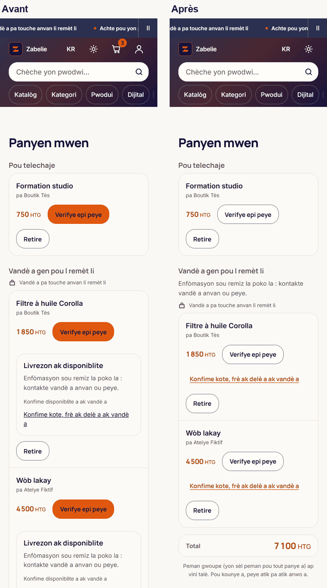
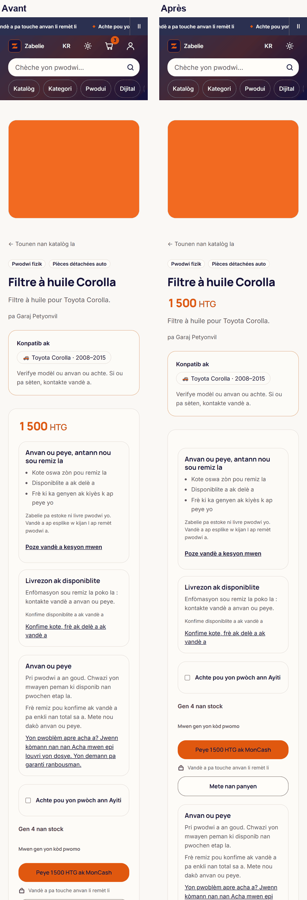
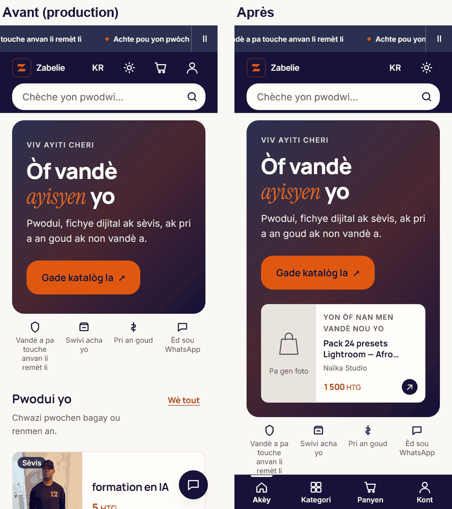
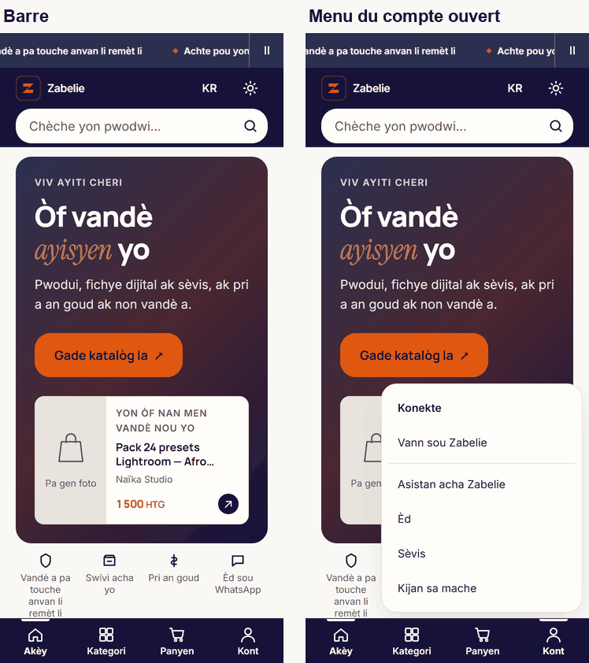
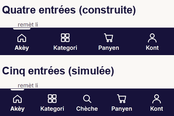

# Phase 4 : parcours d'achat et d'inscription

Chantier design et typographie. Base : `main` après la Phase 3 (#476). Décision : V-28 (`docs/02-DECISIONS.md`), prise par délégation le 2026-11-07 (« Fusionne et Phase 4 »). Mesures du 2026-11-07, à 360 × 800, build local de `main` face au build local de cette branche, mêmes données de test.

## L'essentiel

Sur mobile, une barre en bas de l'écran donne l'accueil, les rayons, le panier et le compte, sous le pouce. L'en-tête mobile perd le panier et le compte, et le bouton WhatsApp flottant de l'accueil disparaît : WhatsApp reste dans le menu du compte. La connexion a un vrai titre, montre le mot de passe à la demande et place le curseur dans le premier champ. Le panier n'a plus trois boutons orange l'un sous l'autre. Sur la fiche produit, le prix passe sous le titre, dans le premier écran.

Aucun fichier sous `app/api` ni `supabase`, aucun fichier du chemin de l'argent (`tests/helpers/chemin-argent.ts`), aucune dépendance ajoutée.

**Deux décisions à prendre.** V-28 prévoyait cinq entrées dans la barre, avec « recherche » ; j'en ai construit quatre, parce que la recherche est déjà collée en haut de chaque page. Les deux options sont capturées plus bas. Et le mot d'accent du titre de connexion coûte 426 ms de LCP en simulation, parce que la page charge une police de plus. **Deux points à relire** : sur l'accueil, la mention « Èd sou WhatsApp » de la barre de confiance n'est pas un lien, et l'inscription descend son bouton de 36 px.

## Critères du brief

| Critère | Résultat | Preuve |
|---|---|---|
| 4.1 Connexion et inscription : carte, titre à mot d'accent, un seul bouton principal, liens en texte, mot de passe visible à la demande, focus, erreurs claires | Tenu | `components/connexion-form.tsx:315`, `:317`, `:355`, `:372`, `:395`, `:472`, `:484` ; `tests/parcours-phase4.test.ts` P1 à P3 |
| 4.2 Connexion par téléphone | Écartée (A17) : aucun fournisseur SMS n'est admis | V-28 |
| 4.3 Phrase de sécurité près des boutons de paiement | Non traitée : A13, arrêt ferme | `OPS_TODO.md`, point 4 |
| 4.4 Présentation du paiement | Panier et fiche seulement (A18) : il n'existe pas de page de commande | `app/panier/page.tsx:128`, `app/produit/[slug]/page.tsx:417` ; P4, P5 |
| 4.5 Barre inférieure, 4 ou 5 entrées, cibles d'au moins 48 px, zone sûre | Tenu : 4 entrées de 90 × 56 px, `env(safe-area-inset-bottom)` | `components/barre-navigation.tsx:65`, `app/marketplace-header.css:36` ; P6 |
| 4.6 WhatsApp discret | Tenu : bouton flottant retiré, lien conservé dans le menu | `components/site-nav.tsx:125` ; `tests/home-premium-structure.test.ts` S7 |
| Captures avant/après | Tenu | `docs/design/phase-4/` |
| Parcours testé à 360 px | Tenu, dans Chrome : barre, menu, Échap, clic extérieur, navigation, panier | Section « La barre, mesurée » |
| Aucun diff sous `app/api` ni dans la logique de paiement | Tenu | `git diff --stat origin/main` : 34 fichiers dont 10 de documentation et d'images, aucun sous `app/api`, `supabase` ou le chemin de l'argent |

## Ce qui a été fait

### Connexion et inscription (brief 4.1)

Le formulaire est posé sur une carte blanche à bord fin (`components/connexion-form.tsx:315`). « Konekte » servait à la fois de titre, d'onglet et de bouton. Le titre dit maintenant où l'on est, avec « Zabelie » en mot d'accent (`:317`) : « Konekte sou Zabelie », « Connexion à Zabelie », « Sign in to Zabelie », « Inicia sesión en Zabelie », et pour l'inscription « Kreye kont ou sou Zabelie » et ses trois traductions.

Le champ mot de passe a un bouton œil qui bascule l'affichage et annonce son état aux lecteurs d'écran (`aria-pressed`, libellé qui change, `:395`). Le curseur se pose dans le premier champ du mode affiché : le nom à l'inscription, l'e-mail à la connexion (`:355`, `:372`). « Modpas bliye ? » devient un lien texte de 44 px (`:472`). Une erreur passe par `MessageErreur`, avec son icône et `role="alert"` ; seuls le succès de l'inscription et le mode démonstration restent un simple message (`:484`).

L'inscription descend son bouton « Kreye kont mwen » de 837 à 873 px : le titre, plus long, passe sur deux lignes. Le bouton était déjà sous le premier écran avant.

### Panier (brief 4.4, A18)

Avec plusieurs articles, chaque ligne avait son bouton orange « Verifye epi peye » : trois boutons principaux à l'écran, dont deux au premier écran. Le bouton n'est orange que s'il est le seul achat possible, c'est-à-dire avec un seul article (`app/panier/page.tsx:128`, `:196`). Avec plusieurs, ils sont tous secondaires, puisque le paiement groupé est fermé et qu'aucun ne prime.

Le bloc « Livrezon ak disponiblite » se répétait sous chaque ligne dont le vendeur n'a rien déclaré. La phrase est dite une fois, en tête du groupe (`:161`), et chaque ligne garde un seul lien pour demander au vendeur (`:199`). Une ligne dont la remise est déclarée garde son bloc complet. Page : 2 244 → 2 033 px.

### Fiche produit (A20)

Le prix était rendu après la description, la compatibilité et la carte d'achat. Il passe juste sous le titre (`app/produit/[slug]/page.tsx:417`) : 976 → 676 px sur une fiche physique, 858 → 711 px sur une fiche numérique, donc dans le premier écran. Le bouton de paiement remonte de 299 px (2 060 → 1 761) et de 226 px (1 238 → 1 012). Il reste précédé, sur un produit physique, du bloc sur la remise : il faut le lire avant de payer, c'est voulu (P5).

La réassurance générale (« Anvan ou peye ») passe sous le bouton (`:698`). Les caractéristiques (poids, dimensions, marque) passent sous la carte d'achat (`:716`) ; la compatibilité véhicule, qui décide l'achat, reste au-dessus (`:539`). Le produit de test n'a pas de caractéristiques renseignées : ce déplacement-là ne se voit pas sur la capture, le test P5 le tient. Enfin la page a un `<main id="main">` (`:348`) : le lien d'évitement de l'en-tête menait nulle part.

### Barre de navigation inférieure (brief 4.5, A19)

Sous 768 px, une barre fixe en bas : Akèy, Kategori, Panyen, Kont (`components/barre-navigation.tsx`). Chaque entrée fait 90 × 56 px à 360 px, 80 × 56 à 320 px. La barre ajoute la zone sûre des téléphones à encoche (`app/marketplace-header.css:36`) et la page gagne sa hauteur en bas, pour que rien ne passe dessous (`:118`). L'entrée de la page courante porte `aria-current="page"`, un trait et un peu plus de gras ; jamais d'orange, réservé à l'action principale (`:91`). Le compteur du panier suit la même règle que celui de l'en-tête : absent à zéro.

« Kont » ouvre le menu du compte vers le haut. Ses liens sont écrits une fois (`components/site-nav.tsx:74`) et servis à deux places complémentaires : l'en-tête à partir de 768 px (`:218`), la barre en dessous (`:250`). La déconnexion reste donc atteignable à toutes les largeurs (`tests/deconnexion.test.ts`). Le menu se referme au clic extérieur, à Échap (le focus revient sur « Kont ») et quand on suit un de ses liens (`components/barre-navigation.tsx:35`).

L'en-tête mobile garde le logo, la recherche, la langue et le thème. Sa hauteur ne change pas (145 px) : le panier et le compte étaient sur la même ligne que le logo.

 

La capture « avant » de l'accueil vient de la production (zabelie.com), en lecture seule : le numéro WhatsApp n'est posé qu'en ligne, donc le bouton flottant n'apparaît dans aucun build local.

### WhatsApp (brief 4.6)

En production, le bouton flottant de 48 px se pose en bas à droite (x = 296, y = 736) et recouvre le contenu. Il aurait recouvert la barre. Il est retiré, et `components/whatsapp-fab.tsx` supprimé. Le lien du menu du compte existait déjà : il devient le seul accès, toujours masqué sans numéro (`components/site-nav.tsx:125`).

À relire : la barre de confiance de l'accueil dit « Èd sou WhatsApp » sans être un lien. Avant, le bouton flottant tenait cette promesse à côté. La rendre cliquable quand le numéro est posé est une petite modification de `TrustBar`, que je n'ai pas faite sans votre avis.

## Quatre entrées ou cinq

V-28 prévoyait « accueil, rayons, recherche, panier, compte ». La recherche est déjà une barre collée en haut de chaque page, y compris quand l'en-tête se replie au défilement. Une entrée de plus la doublerait et ramènerait chaque cible de 90 à 72 px de large. La cinquième option ci-dessous est **simulée** : une entrée clonée et injectée dans la page, rien n'est construit. Elle s'ajoute en une ligne si vous la préférez.

## La barre, mesurée

Dans Chrome, build local, sonde éprouvée au démarrage sur une page jetable (un élément fixe parasite détecté puis absent). Outil : `Zabelie-notes/design-typo-outils/barre-p4.cjs`.

| Contrôle | Résultat |
|---|---|
| Barre à 360 × 800 | y = 743 à 800, hauteur 57 px |
| Entrées | 4 × (90 × 56 px), `aria-current` sur Akèy à l'accueil |
| Libellés à 320 px, toutes les entrées forcées en gras, quatre langues | 1 ligne chacun, aucune troncature |
| Dernier lien du pied de page, page défilée au bas | au-dessus de la barre |
| Menu du compte ouvert | 445 → 736 px, dans l'écran, au-dessus de la barre |
| Échap | menu fermé, focus sur « Kont » |
| Clic extérieur | menu fermé |
| Navigation par la barre vers les rayons | `aria-current` passe sur Kategori |
| Panier avec trois articles | entrée active, compteur « 3 », nom accessible « Panyen (3) » |
| 768 et 1 280 px | aucune barre, panier et compte dans l'en-tête, aucune marge ajoutée en bas |
| Autres éléments fixes à l'accueil | aucun |

Un défaut trouvé par ces mesures, et corrigé avant ce rapport : en gras, « Panyen mwen » se coupait sur deux lignes et l'icône sortait par le haut de la barre. La barre a ses propres libellés courts (`nav.bar.cart`, `nav.bar.account`), sur une ligne imposée. La sonde a été passée sur l'ancien build d'abord : elle y voyait bien les deux lignes.

## Cibles et premier écran, toutes pages

Même sonde qu'en Phase 2 (`mesure-p2.cjs`, auto-testée). Aucune cible sous 44 px, avant comme après, sur l'accueil, les rayons, la connexion, l'inscription, deux fiches et le panier.

| Page | Bouton orange au premier écran, avant → après |
|---|---|
| Accueil, rayons, connexion | 1 → 1 |
| Panier (3 articles) | 2 → 0 |
| Inscription, fiches | 0 → 0 (sous le premier écran, voir plus haut) |

## Performance

Lighthouse 12.8.2, mobile, 4G lent simulé, builds locaux, trois passages entrelacés par page, médianes. Outil : `Zabelie-notes/design-typo-outils/lh-local.sh`.

| Page | LCP (ms) | FCP (ms) | TBT (ms) | CLS | Accessibilité | JavaScript transféré |
|---|---|---|---|---|---|---|
| Accueil | 2 979 → 2 997 | 1 821 → 1 818 | 68 → 106 | 0 → 0 | 100 → 100 | 179,4 → 179,3 Kio |
| Fiche | 2 919 → 2 909 | 1 532 → 1 527 | 59 → 109 | 0 → 0 | 98 → **100** | 171,2 → 171,1 Kio |
| Connexion | 2 876 → **3 302** | 1 522 → 1 663 | 98 → 61 | 0 → 0 | 100 → 100 | 237,9 → 237,7 Kio |

La barre n'ajoute aucun JavaScript mesurable. Le TBT des pages qui la portent monte de 38 et 50 ms en médiane, sous le seuil de 200 ms, avec une forte dispersion (59 à 133 ms à l'accueil après, 50 à 82 avant) ; la connexion, sans barre, baisse de 37 ms. Trois passages ne suffisent pas à trancher entre l'hydratation de la barre et le bruit. La fiche gagne 2 points d'accessibilité avec son `<main>`.

**À arbitrer : le LCP de la connexion monte de 426 ms.** L'élément LCP est le titre, qui porte maintenant le mot d'accent « Zabelie » : la page télécharge la police d'accent (12 Kio), qu'elle n'employait pas, et le LCP attend son arrivée sur deux passages sur trois (3 307 et 3 302 ms ; le troisième, 2 828). Le texte, lui, s'affiche dès le premier rendu dans la police de repli ajustée, sans décalage (CLS 0). Comme toutes les polices du site, elle n'est pas préchargée : la précharger partout ferait payer 12 Kio à chaque page. Deux options :

- garder le titre à mot d'accent, comme le demande le brief (4.1) et comme pour l'accueil en Phase 3 (« Garder l'accent », V-27) : c'est l'état de cette branche ;
- garder « Konekte sou Zabelie » sans police d'accent : une ligne à changer (`components/connexion-form.tsx:317`), LCP revenu vers 2,9 s.

## Tests

`tests/parcours-phase4.test.ts`, six tests : P1 à P3 (connexion), P4 (panier), P5 (fiche), P6 (barre). S7 réécrit (WhatsApp), H4 et H6 de `tests/home-premium-header.test.ts` et le test de déconnexion suivent la nouvelle structure du menu. Chaque garde porte sur ce qui commande : la condition, la source, la classe, jamais un libellé seul.

Mutations passées, toutes rouges : barre visible sur ordinateur, cible ramenée à 40 px, zone sûre retirée, `display` ajouté hors couche (il l'emporterait sur `md:hidden`), `aria-current` du panier branché sur l'accueil, lien WhatsApp sans numéro, panier en double sur mobile, accueil allumé sur toutes les pages, préfixe de mot pris pour une sous-page, page sans réserve en bas, état actif orange, compteur affiché à zéro, menu de l'en-tête masqué jusqu'à `lg`, retour à la ligne permis, libellé long dans la barre, libellé kreyòl trop long, déplacement des caractéristiques annulé.

Suite complète sous Windows : 2 838 tests sur 2 839. Le seul échec est connu et sans rapport avec cette phase : `tests/zone-acheteur.test.ts` compare des chemins écrits avec `/` à ceux que Windows rend avec `\`.

Trois échecs de la suite complète venaient de cette phase et sont corrigés. Des rayons et un espacement écrits en pixels dans la barre passent en tokens (`tests/design-echelles.test.ts` E6). Le mot de passe à bascule, dont le type est désormais calculé, sortait en silence du contrôle d'`autoComplete` : le test le reconnaît de nouveau (`tests/champs.test.ts` C5, mutation à l'appui). Le compte des appelants de `MetricA` passe de trois à deux, le bouton flottant supprimé en étant un (`tests/boutons-typographie.test.ts` B4).

## Notes laissées par la Phase 2

- La recherche de l'en-tête devait être revue avec lui : elle reste une pilule de 44 px, puisque la barre inférieure prend déjà 57 px en bas de l'écran et que 44 px tiennent la cible tactile (`tests/champs.test.ts`).
- Les listes de compatibilité véhicule du formulaire vendeur, en français sans clé i18n, devaient être traduites ici : elles sont hors du parcours acheteur de la Phase 4, et reportées en Phase 5.

## Ce qui reste au porteur

- Quatre ou cinq entrées dans la barre (`OPS_TODO.md`, point 9).
- Le mot d'accent du titre de connexion, et ses 426 ms (section « Performance »).
- « Èd sou WhatsApp » cliquable ou non.
- A11 et A13, arrêts fermes, et la présentation des fichiers du chemin de l'argent : inchangés.
